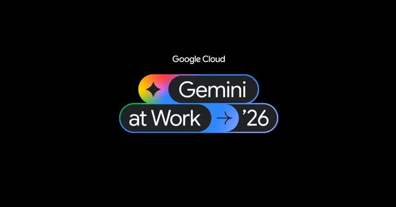
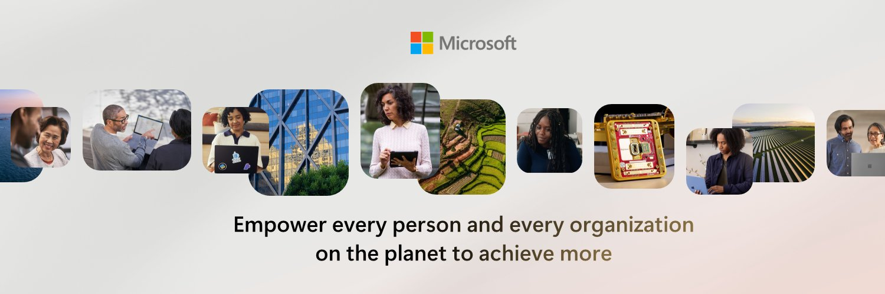

## TLDR

- **Open weights are winning the margin fight:** Meta and Microsoft cut Claude usage by up to half, and Reflection AI's Beam gives American companies an open model they can tune and own.
- **Google gave Gemini a badge:** at Gemini at Work, Gemini became one agent with its own Workspace identity, a defined role, subagents, and real-time spend caps.
- **Satya Nadella says treat models as insider risks, and the power goes to whoever owns the runtime:** that is a cloud, not a model vendor. Controls belong outside the model.
- **Our play:** route high-volume tasks to open weights on Gemini Enterprise Agent Platform (FKA Vertex AI), contain agents with Agent Runtime, and distill frontier reasoning into customer-owned Gemma students.

## The Big Picture: Open Weights, Agent Identity, and Who Controls the Model

### Open Weights Win the Margin Fight: Meta and Microsoft Trim Claude, and Reflection's Beam Gives Them Somewhere to Go

Meta moved 30,000 engineers, half its Claude Code seats, onto its in-house MetaCode tool, cutting monthly Anthropic spend to $105M [AI Daily Brief (28 min watch, 09:45)](https://podcasters.spotify.com/pod/show/nlw/episodes/Point-Counterpoint-Consumers-Will-Never-Pay-for-AI-e3q16j9). Microsoft rationed internal cloud use by 33%, swapping in in-house models and GPT-5.6 [@ns123abc (1 min read)](https://x.com/ns123abc/status/2107231548428972138). The reason is margin: inference hits $130B this year and turns every app into a reseller whose margins decay unless token overhead shrinks [Tom Tunguz (2 min read)](https://x.com/ttunguz/status/2107112425111887879). Open weights reached a record 78.4% of token volume on Vercel AI Gateway [Guillermo Rauch on AI Daily Brief (27 min watch, 23:55)](https://podcasters.spotify.com/pod/show/nlw/episodes/Why-Companies-Want-AI-They-Can-Own-e3pv4le).

Now there is an American open model to move to. Reflection AI's Beam, 501B parameters, claims 3–4x better inference efficiency than GLM 5.2 and scores 80.1 on Terminal Bench 2.1 [AI Daily Brief (28 min watch, 03:15)](https://podcasters.spotify.com/pod/show/nlw/episodes/Point-Counterpoint-Consumers-Will-Never-Pay-for-AI-e3q16j9). The pitch is cost, not raw capability: it scores 44.4 on DeepSwe, below Qwen3 Max. It attacks the closed labs where they are weakest: customers cannot tune their models ("You cannot fine-tune Luna" [AI Daily Brief (27 min watch, 20:05)](https://podcasters.spotify.com/pod/show/nlw/episodes/Why-Companies-Want-AI-They-Can-Own-e3pv4le)). Closed labs still lead at the top of the range, so the pressure lands on high-volume mid-tier traffic. For a founder with a "no Chinese weights" procurement rule, Beam is now a candidate.

**Your angle with founders**

- Grant that Claude is still the developer favorite, then offer an eval: test an open model on their high-volume background calls.
- **Where GCP wins:** Model Garden runs Claude, Gemini, and open weights side by side, so rerouting is a config change.

### Gemini Gets a Badge: Google Just Hired Your Company's Newest Coworker

This is the big one. At Gemini at Work '26, Google Cloud launched Gemini: one universal agent that takes an objective instead of instructions, plans the work, and spawns subagents. It can be a "coworker agent" with a defined role and its own identity [Thomas Kurian (1 min read)](https://x.com/ThomasOrTK/status/2108245829530325307), down to a Workspace email address [TechCrunch (4 min read)](https://x.com/TechCrunch/status/2108260918350008526).

It plugs into Workspace, Microsoft 365, Slack, Jira, BigQuery, Snowflake, and any MCP server, lets you pick models including Claude, and ships with real-time spend caps. Sundar Pichai said Gemini has over 1B monthly users and about 90% of the Fortune 100 use Gemini Enterprise.

Each feature closes a gap that stalls agents in production: identity makes every action traceable, subagents remove the human stitching steps together, and spend caps turn an open-ended token bill into a budget. Confirm pricing and availability dates before quoting it; launch coverage gave neither. Pitch it as the badge founders have been asking for, with Claude alongside Gemini either way.

### Satya Nadella: Treat Models as Insider Risks

Two days after Google's launch, Microsoft's CEO published the doctrine. Nadella argues we cannot trace model behavior to specific training data or weights, so enterprises must "separate the supply of intelligence from the authority over it." Frontier closed and open-weight models should be treated as insider risks, not because they are malicious but because any capable actor can err or be compromised [Satya Nadella (4 min read)](https://x.com/satyanadella/status/2108931348857827686).

The controls must sit outside the model, and he lists seven tests: model diversity, observe everything, verifiability, independent controls, independent auditability, containment with an emergency brake, and incident disclosure. David Sacks endorsed it, calling engineering safety a different thing from alignment [David Sacks (1 min read)](https://x.com/DavidSacks/status/2109004929943695870). AWS CEO Matt Garman made a similar move the same week, unveiling agent-native primitives: ephemeral databases that spin up in three seconds, execution sandboxes, and dedicated agent permissions [Matt Garman via a16z (1 min read)](https://x.com/a16z/status/2108287764303372392). My read: the doctrine favors whoever owns the runtime, which is a cloud, not a model vendor.

**Your angle with founders**

- Score the Gemini agent against his list honestly: identity and model diversity are in the launch, but spend caps are a cost brake, not a safety brake, and nothing public confirms tamper-proof logs or a mid-task emergency stop.
- **Where GCP wins:** Agent Runtime adds managed sessions, OpenTelemetry observability, and VPC Service Controls; Model Armor screens prompts and responses for injection and data leakage.

## Quick Hits

- **[Google DeepMind open-sources EmbeddingGemma 2 (1 min read)](https://blog.google/innovation-and-ai/technology/developers-tools/embeddinggemma-2/)** — An open 740M-parameter model indexes text, code, images, video, and audio, and runs in a browser at roughly 20–70ms per query with no API key [@victormustar (1 min read)](https://x.com/victormustar/status/2107521244870615416). Health, legal, and finance founders get private on-device search at no per-query cost.
- **[Isomorphic Labs joins the Virtual Biology Initiative (1 min read)](https://x.com/IsomorphicLabs/status/2107820493940122052)** — The Alphabet drug-discovery company pools funding and data toward an open biology dataset. Context for life-science founders, not a buying signal.
- **[Cloudflare open-sources Clef routing models (1 min read)](https://x.com/MiaAI_lab/status/2105937377910808756)** — Routing decisions with zero text generation.
- **[Google Cloud details Borderless Lakehouse (15 min read)](https://x.com/GoogleCloudTech/status/2108260348352409876)** — BigQuery queries AWS and Azure data zero-copy, no egress fees.

## Seller's Edge: Separate Intelligence from Authority

Edition #17 taught selling the substrate beneath commoditizing models, and Edition #33 showed why state compounds while intelligence commoditizes. This week adds the authority boundary. Satya Nadella says to treat frontier models as insider risks: capable, but impossible to verify from the inside [Satya Nadella (4 min read)](https://x.com/satyanadella/status/2108931348857827686). So the model may propose an action, but something outside it decides whether the action runs.

Picture a founder who hands an agent one broad service account. One prompt injection and the agent can touch everything, because the model and the authority are the same thing.

Ask in your next meeting: *"Where does your agent's authority live: in its prompt, or in the runtime that enforces its permissions?"* Then help them sketch the fix: the model proposes, the cloud checks identity, enforces least privilege, and holds the kill switch.

## Our Play

One position: **the substrate where founders govern agents, protect margins, and own their models.**

- **Route high-volume tasks for margin on Agent Platform.** *Signal:* Meta and Microsoft cut Claude bills. *Why GCP wins:* Model Garden serves 200+ models behind one API. *The move:* benchmark their top-volume step on Gemini 3.8 Flash or Gemma.
- **Contain agents with Agent Runtime and Model Armor.** *Signal:* Nadella wants controls outside the model. *Why GCP wins:* VPC Service Controls, observability, and prompt screening. *The move:* audit agents sharing one credential, then move them to Agent Runtime.
- **Distill frontier reasoning into customer-owned Gemma students.** *Signal:* inference migrates to cheaper models. *Why GCP wins:* Agent Platform tunes an open Gemma student the customer owns. *The move:* benchmark a student on their most repeated workflow.

**Distillation, in plain terms.** A big "teacher" model works the customer's real tasks; a small open "student" (Gemma) learns to imitate it. The student is cheaper and owned. Limits: it needs the founder's own test set, the teacher's terms must allow training on its outputs, and the managed Gemini Distillation Service is Gemini-to-Gemini only.

---

*Sources: 94 bookmarks, 5 podcast episodes, 36 lab announcements from the AI content library. [Archive](/archive)*
