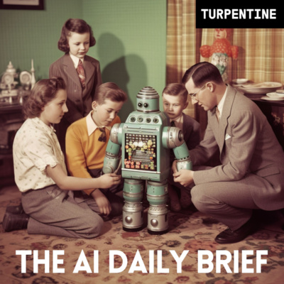

## TLDR

- **Meta and Microsoft slashed Claude usage by up to 50%,** substituting in-house and open models as Anthropic faces 25% revenue concentration ahead of its IPO.
- **Satya Nadella defined AI models as enterprise "insider risks,"** aligning cloud hyperscalers around runtime containment, scoped agent identity, and sandboxed execution.
- **Reflection AI launched 501B open model Beam,** securing $7.3B in neocloud debt to challenge frontier labs on inference token efficiency.
- **Our play:** route high-volume tasks to open weights on Gemini Enterprise Agent Platform (FKA Vertex AI), isolate agent execution with Agent Runtime, and distill frontier reasoning into customer-owned Gemma students.

## The Big Picture: Token Economics, Runtime Governance, and Sovereign Open Weights

### The Enterprise Model Defection: Meta and Microsoft Wean Off Claude as Anthropic Faces 25% Concentration Risk

Meta completed an internal migration shifting 30,000 engineers—half its Claude Code seats—to its in-house MetaCode tool, compressing monthly spend with Anthropic to $105M after pacing several billion annualized in June [AI Daily Brief (28 min watch, 09:45)](https://podcasters.spotify.com/pod/show/nlw/episodes/Point-Counterpoint-Consumers-Will-Never-Pay-for-AI-e3q16j9). Microsoft simultaneously rationed internal cloud use by 33%, substituting Claude for in-house models and GPT-5.6 [@ns123abc (1 min read)](https://x.com/ns123abc/status/2107231548428972138). These defections land as private disclosures reveal Anthropic's customer concentration ahead of an anticipated IPO: just two accounts drove 25% of 2025 revenue, with only 100 enterprise customers spending over $10M annually [AI Daily Brief (28 min watch, 10:40)](https://podcasters.spotify.com/pod/show/nlw/episodes/Point-Counterpoint-Consumers-Will-Never-Pay-for-AI-e3q16j9).

This belt-tightening mirrors a structural shift in software margins. Tom Tunguz notes the AI inference market will reach $130B this year on its way to $350B by 2027, mutating every application into an inference reseller whose gross margins decay unless token overhead is compressed [Tom Tunguz (2 min read)](https://x.com/ttunguz/status/2107112425111887879). On Artificial Analysis evals, Claude Opus costs $5.98 per benchmark task versus $3.26 for GPT-6 Astra and $0.72 for Sol [@iAmHenryMascot (1 min read)](https://x.com/iAmHenryMascot/status/2107248040964677702). When open weights hit a record 78.4% of token volume on Vercel AI Gateway [Guillermo Rauch on AI Daily Brief (27 min watch, 23:55)](https://podcasters.spotify.com/pod/show/nlw/episodes/Why-Companies-Want-AI-They-Can-Own-e3pv4le), the message is clear: closed frontier labs price themselves as indispensable monopolies, but their largest sponsors are already defection-testing their stacks.

**Your angle with founders**

- **The conversation to skip:** debating whether Claude 3.5 Sonnet is marginally better at writing code. For bespoke developer workflows, Sonnet remains the developer darling—grant it plainly and let engineers keep it.
- **The decomposition to run live:** break their token bill into exploratory reasoning versus high-volume background execution. As Meta and Microsoft proved, paying frontier seat prices on repetitive production calls destroys unit economics as volume scales.
- **The question to leave behind:** "If your primary model provider raised API prices or suffered rate limits tomorrow, how many hours does it take to route your background traffic to an open-weight fallback?"
- **Where GCP wins:** Model Garden runs Claude, Gemini, and open weights side by side, so routing high-volume steps to cost-effective models is an API config change rather than a code rewrite.

### Agent Runtimes vs. Model Vaults: The Hyperscaler Substrate Counter-Offensive

Satya Nadella published an architectural manifesto defining frontier AI models as enterprise "insider risks" [Satya Nadella (4 min read)](https://x.com/satyanadella/status/2108931348857827686). Rejecting model self-alignment as an uncheckable black box, Nadella argued enterprises must separate the supply of intelligence from authority over it, surrounding non-deterministic models with external deterministic controls, non-human identity, and immutable audit logs. The same week, AWS CEO Matt Garman unveiled agent-native cloud primitives—including ephemeral databases that spin up in three seconds, execution sandboxes, and dedicated agent permissions [Matt Garman via a16z (1 min read)](https://x.com/a16z/status/2108287764303372392). Meanwhile, Google Cloud launched its universal Gemini agent featuring dedicated Workspace identity, role-scoped email addresses, subagent orchestration, and real-time spend caps at Gemini at Work '26 [TechCrunch (4 min read)](https://x.com/TechCrunch/status/2108260918350008526) alongside Data Agent Kit GA [Google Cloud (1 min read)](https://cloud.google.com/blog/products/data-analytics/whats-new-with-google-data-cloud/).

This marks a coordinated hyperscaler counter-offensive against frontier labs. Labs like OpenAI (with Dots and Space) and Anthropic want to host enterprise agent execution, memory, and files inside proprietary API vaults. But enterprise infrastructure cannot treat autonomous agents like human employees with broad trust. By treating models as untrusted insider risks bounded by cloud-native permissions, kernel sandboxes, and independent auditability, hyperscalers are reasserting that the execution runtime belongs to the cloud, not the model vendor.

**Your angle with founders**

- **Open with the uncomfortable version:** frontier models cannot verify their own safety, and prompt guardrails fail under adversarial tool use. Nobody's agent stack is immune to unintended actions by default.
- **Three checks to run on their architecture:** inspect whether autonomous agents share a static API key or hold Non-Human Identities, whether code-execution steps run in shared containers or isolated kernels, and whether operators have an emergency brake mid-task.
- **Name products against those failures, limits included:** Model Armor inspects prompts inline—effective against injection, but blind to plain-language collusion. Cloud Run Sandboxes (gVisor) isolate code execution, while Security Command Center AI Protection governs per-agent identity and tool audits.
- **Where GCP wins:** agent governance built into the cloud substrate, ensuring untrusted model reasoning never executes without deterministic privilege boundaries and audit trails.

### The $25B Open-Weight Gambit: Reflection AI Launches 501B Beam via $7.3B in Neocloud Debt Deals

Reflection AI released Beam, a 501B-parameter open-weight foundation model claiming 3–4x inference compute efficiency over GLM 5.2 and topping agent benchmarks with an 80.1 on Terminal Bench 2.1. Valued at $25B before shipping a public model, the startup secured massive alternative compute packages totaling $7.3B—including $6.3B with SpaceX and $1B with Nebius. The launch represents an aggressive bid to establish a sovereign American open-source champion capable of rivaling Chinese open models like Kimi K3 and GLM.

The move highlights how foundation model economics are fragmenting. On Unsupervised Learning, Applied Compute CEO Yash Sharma argues post-training on open weights wins inference because high-volume production inevitably migrates down the Pareto curve to optimize cost and latency [Yash Sharma on Unsupervised Learning (57 min watch, 35:15)](https://www.youtube.com/watch?v=QeiYSLBCwD4). But Reflection AI's heavy reliance on debt facilities highlights the fragility of challenger clouds. As AI absorbs 81% of US venture capital [Kyle Harrison (14 min read)](https://x.com/kwharrison13/status/2108931049506083092), model builders face a stark choice: absorb neocloud debt exposure or build on hyperscalers that can guarantee multi-year infrastructure delivery. Meanwhile, open architectures are proliferating everywhere from Cloudflare's Clef decision models [@MiaAI_lab (1 min read)](https://x.com/MiaAI_lab/status/2105937377910808756) to multi-model integrations across consumer agents [@thatguybg (1 min read)](https://x.com/thatguybg/status/2107774058180059429).

## Quick Hits

- **[Google DeepMind open-sources EmbeddingGemma 2 for on-device multimodal RAG (1 min read)](https://blog.google/innovation-and-ai/technology/developers-tools/embeddinggemma-2/)** — Sundar Pichai unveiled an open 740M multimodal embedding model handling text, code, audio, and video in-browser via WebGPU at 20–70ms.
- **[Cloudflare open-sources Clef decision models to eliminate generative routing overhead (1 min read)](https://x.com/MiaAI_lab/status/2105937377910808756)** — A frozen Qwen backbone paired with a parallel schema head scores routing options with zero text generation at 4x Jev's speed.
- **[Google Cloud details Borderless Lakehouse to eliminate multi-cloud data egress fees (15 min read)](https://x.com/GoogleCloudTech/status/2108260348352409876)** — BigQuery and Gemini can query AWS and Azure data zero-copy with flat-rate interconnect economics across Databricks Unity, Snowflake Horizon, and AWS Glue.
- **[Meta and Sierra launch the open Personal Agent Protocol with Walmart, Stripe, and Shopify (5 min read)](https://x.com/btaylor/status/2107535182119244176)** — Bret Taylor unveiled an open OAuth-based standard defining how personal AI agents securely discover and execute commercial transactions across merchant websites and APIs.

## Seller's Edge: Separating Intelligence from Authority (The "Insider Risk" Model)

Edition #17 taught selling the substrate beneath commoditizing models, and Edition #33 diagnosed why state compounds while intelligence commoditizes; this week adds the authority boundary. Satya Nadella's architectural manifesto [Satya Nadella (4 min read)](https://x.com/satyanadella/status/2108931348857827686) defines frontier models as enterprise insider risks: highly capable actors whose inner reasoning traces cannot be mechanistically verified. When an agent fails, it is rarely because it lacked intelligence; it is because an unverified reasoning step was granted deterministic authority to modify production state. Safety cannot be outsourced to model-level alignment or prompt instructions. You must separate the supply of intelligence from the authority over execution.

Consider how early-stage builders assemble autonomous agents today. A founder connects Claude Code or OpenAI's new agent primitives to a broad service account, giving the model direct credentials to query databases, write code, and trigger API calls. When the model encounters a prompt injection or a hallucinated tool parameter, the entire system is compromised because the model and the execution authority were collapsed into the same runtime. Treating the model as an insider risk means assuming it is compromised from day one: stripping it of ambient credentials, routing every action through external deterministic policy gates, and logging every turn to tamper-proof storage.

In your next founder meeting, stop arguing over which model family hallucinates less. Ask: *"Where does your agent's authority boundary sit—inside the model's system prompt, or in the cloud runtime enforcing its permissions?"* Help the founder whiteboard an architecture that treats models as interchangeable, untrusted reasoning engines. The model supplies the proposed action; your cloud infrastructure validates identity, enforces least-privilege sandboxes, and holds the kill-switch.

## Our Play

Every thread this edition—model defection, agent governance, and open weights—points to one GCP position: **the substrate where founders govern agent authority, protect margins, and own their models.** Three concrete motions:

- **Route high-volume tasks for margin on Agent Platform.** *Signal:* Meta and Microsoft cut Claude bills by routing background volume to open weights. *Why GCP wins:* Model Garden serves 200+ models behind one API, letting founders swap models via config without refactoring. *The move:* Benchmark their highest-volume step on Gemini 3.8 Flash or open Gemma.
- **Isolate agent authority with Agent Runtime and Model Armor.** *Signal:* Agents are insider risks requiring external deterministic guardrails. *Why GCP wins:* Agent Runtime isolates execution, Model Armor inspects prompts inline, and Security Command Center AI Protection governs per-agent Non-Human Identities. *The move:* Audit their agent permissions and deploy Agent Runtime with scoped identities.
- **Distill frontier reasoning into customer-owned Gemma students.** *Signal:* Production inference migrates down the Pareto curve to optimize cost. *Why GCP wins:* Agent Platform enables distillation from Gemini teachers into owned Gemma models, served on TPU 8i for superior price-performance. *The move:* Benchmark their primary reasoning workflow on a distilled Gemma student.

---

*Sources: 94 bookmarks, 5 podcast episodes, 36 lab announcements from the AI content library. [Archive](/archive)*