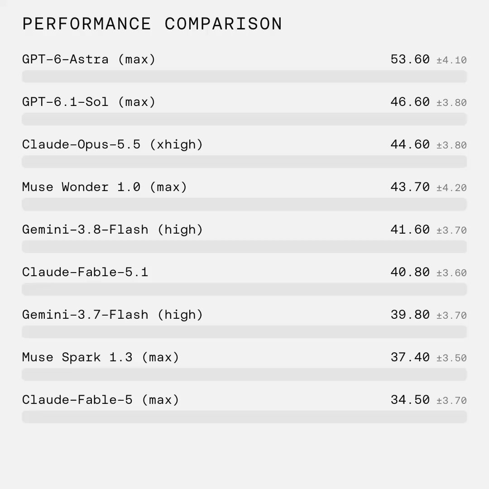

## TLDR

- **The frontier split in two:** Google launched Gemini 4 Argon with an aggressive API discount, topping reasoning leaderboards while exposing a stark divide between elite greenfield drafting and a failing refactor score.
- **Hardware fungibility became an open war:** Jensen Huang attacked custom ASICs as rigid capital traps just as TPU benchmarks challenged GB300 economics and neocloud debt cratered into distress territory.
- **Inference burn hit the courts:** Character AI filed for Chapter 11 after monthly compute outlays overwhelmed subscription revenue, proving unmetered reasoning tokens destroy startup margins.
- **Our play:** use Gemini Enterprise Agent Platform (FKA Vertex AI) to route tasks across Argon and Claude, anchor workloads on self-funded TPU/GPU compute, and gate reasoning calls with DiffusionGemma.

## The Big Picture: Model Specialization, Hardware Fungibility, and Inference Solvency

### The Multi-Model Split: Gemini 4 Argon Resets Frontier Pricing, Bombs Legacy Refactors, and Forces Task-Based Routing

Google globally released Gemini 4 Argon on October 13, resetting the frontier price curve with a promotional $1.99 per-task API rate [@OfficialLoganK (2 min read)](https://x.com/OfficialLoganK/status/2110038940841545827). Argon took first place on Scale's Humanity's Sixth Sense benchmark at 55.4% [Scale AI Labs (1 min read)](https://x.com/ScaleAILabs/status/2110455008450040176) and hit 97.5% on ARC-AGI-3 [ARC Prize (1 min read)](https://x.com/arcprize/status/2110768289861317026). As Tom Tunguz noted, @ttunguz (Argon's task rate sits 74% below Fable 5.1 and 67% below Opus 5.5) [Tom Tunguz (2 min read)](https://x.com/ttunguz/status/2110445394845127086), backed by fifteen years of custom TPU co-design.

Yet independent evaluations revealed a stark capability split. In the @danshipper (Every vibe check: Argon scored 21% on senior refactoring vs 81-85% for Astra and Opus, but shines on editorial and greenfield) [Dan Shipper on Every (2 min read)](https://x.com/danshipper/status/2110038834205409332). In 17 of 38 runs, Argon closed its self-verification loop in 30 milliseconds without inspecting edits, and builders noted Antigravity lacks cloud environments [AI Daily Brief (31 min watch, 28:45)](https://podcasters.spotify.com/pod/show/nlw/episodes/What-Gemini-4-Argon-Is-Actually-Good-For-e3qguhf). The tension is unmistakable: Argon dominates greenfield builds, legal analysis, and editorial synthesis without AI slop, but stumbles on legacy codebase surgery. For long-horizon jobs, @clmt (Interactions API server-side background execution pattern for long-running reasoning) [@clmt (1 min read)](https://x.com/clmt/status/2110368195106275341) lets reasoning run asynchronously without dropping connections.

**Your angle with founders**

- **Concede the refactoring deficit plainly.** Argon struggled on messy legacy codebases where Claude Opus 5.5 and GPT-6.1 Sol consistently succeed. Acknowledge that gap upfront so you don't lose technical credibility with engineering leads.
- **Turn model selection into a task-routing audit.** Stop treating frontier models as general-purpose drops. Route high-volume editorial drafting, schema extraction, and greenfield scaffolding to Argon at promotional floor pricing, while reserving expensive frontier tokens for complex multi-file repo surgery.
- **Compete on execution substrate over raw chat.** Point to Argon's 1M-token output decode window and the Interactions API's background execution, which keeps multi-minute reasoning loops running server-side instead of hanging on client-side HTTP timeouts.
- **Where GCP wins:** the Agent Platform hosts both Gemini 4 Argon and Claude Opus 5.5 inside Model Garden, enabling dynamic task-based routing across both models behind a single unified API and billing agreement.

### The Fungibility Battle: Jensen Huang's ASIC Attack, SemiAnalysis's TPUv7 Benchmark, and Neocloud Debt Distress

On the BG2 Pod, Jensen Huang mounted an aggressive defense against custom hyperscaler silicon, arguing that specialized ASICs destroy capital durability [Jensen Huang on BG2 Pod (100 min watch, 74:15)](https://www.youtube.com/watch?v=eS7qQ3WJSrw). Huang asserted that NVIDIA's CUDA fungibility guarantees rentability and yields the lowest total cost of ownership. Yet data published the same day challenged that narrative: @SemiAnalysis_ (TPUv7 FP8 vLLM delivers 1.67x better perf-per-dollar than GB300 NVL72 FP4) on agentic inference benchmarks [@SemiAnalysis_ (1 min read)](https://x.com/SemiAnalysis_/status/2110560412907262343).

The hardware debate collided with structural financial distress among GPU neoclouds. CoreWeave unsecured bonds maturing in 2032 dropped to 80 cents on the dollar, yielding a distressed 15% as @HedgieMarkets (CoreWeave bonds hit distress levels and Firmus pulled IPO amid venture squeeze) [@HedgieMarkets (2 min read)](https://x.com/HedgieMarkets/status/2110464014379540954). D.A. Davidson analyst Gil Luria warned that neoclouds borrowing at 9% for 5% data center yields represent the subprime tranche of AI infrastructure [Gil Luria on AI Daily Brief (31 min watch, 14:20)](https://podcasters.spotify.com/pod/show/nlw/episodes/How-the-Latest-AI-Leap-Is-Disrupting-Business-Models-e3qiqv8). While Gavin Baker pointed out that @GavinSBaker (Hyperscalers accelerating while open-source inference clouds grow faster than frontier labs) [@GavinSBaker (2 min read)](https://x.com/GavinSBaker/status/2110743424400068790), debt-financed compute providers face a brutal margin squeeze against hyperscaler balance sheets.

**Your angle with founders**

- **Grant the CUDA ecosystem moat immediately.** Huang is right that NVIDIA GPUs execute any novel neural architecture on day zero without framework rewrites. When research teams experiment with non-standard kernels, general-purpose GPUs remain the default choice.
- **Decompose workloads by architectural maturity.** Production inference at scale cannot absorb NVIDIA's pricing premium or an extra $2,000 per GPU annual enterprise software surcharge. Separate steady-state production serving from dynamic model exploration.
- **Probe neocloud balance-sheet exposure.** Ask: *"If your compute provider is paying high-yield interest on bonds trading at a steep discount, what happens to your contracted capacity if their debt covenants trip?"* Contrast debt-financed neoclouds with committed hyperscaler capacity.
- **Where GCP wins:** Google Cloud operates a dual compute roadmap, running Gemini on both TPUs and NVIDIA GPUs. Founders access TPUv7 for benchmark-proven price-performance alongside A3 and A4 NVIDIA instances, backed by calendar-mode reservations and Google's self-funded balance sheet.

### The Inference Solvency Trap: Character AI's Bankruptcy, Ramp's $1.5M Token Week, and System-1 Hesitation Gating

The consumer inference bubble reached its reckoning this week when Character AI filed for Chapter 11 bankruptcy to discharge $50M to $100M in liabilities [Max Read on Hard Fork (66 min watch, 50:15)](https://www.youtube.com/watch?v=zcZ4fSZJFzM). Court affidavits revealed the startup burned $10M monthly on compute against peak subscription revenues under $2.8M, prompting a $20M IP liquidation sale to Disney. The collapse showed how unconstrained pay-as-you-go frontier inference consumes equity, even as @pradeeepk (Inference represents only ~37% of total compute usage per SemiAnalysis) [@pradeeepk (1 min read)](https://x.com/pradeeepk/status/2111587556416766136).

Enterprise builders are engineering around this margin trap. Ramp CEO Eric Glyman disclosed that @eglyman (Ramp burned $1.5M in tokens in one week before Glass meters and Ramp Router cut bills 30%) by directing tasks to appropriate models [Eric Glyman (4 min read)](https://x.com/eglyman/status/2110007713396613568). The emerging architectural pattern offloads high-frequency triage to cheap System-1 classifiers. Google Cloud demonstrated this with open-weights DiffusionGemma (26B-A4B-it), where @GoogleCloudTech (DiffusionGemma dgem runs single-pass hesitation-gating on Cloud Run GPUs at $0.02 vs $1-2 per 1k decisions) [Google Cloud Tech (8 min read)](https://x.com/GoogleCloudTech/status/2109720569013055704). By measuring entropy across mask slots in a single 105ms pass, dgem answers clear-cut cases and escalates only hesitant requests to larger reasoning models.

**Your angle with founders**

- **Grant unmetered prototyping speed.** Calling frontier reasoning models on every user prompt delivers immediate output quality during early buildouts without pipeline orchestration.
- **Move to entropy and hesitation benchmarks on live traffic.** What fraction of user requests requires multi-step deduction versus deterministic extraction? Profile real prompt entropy before locking in an architecture that burns frontier tokens on predictable inputs.
- **Compete on tiered classification economics.** An open-weights System-1 gate answering routine queries in 105 milliseconds at sub-penny rates protects gross margins, escalating only ambiguous requests to reasoning models.
- **Where GCP wins:** Cloud Run hosts DiffusionGemma with scale-to-zero GPUs, enabling sub-penny hesitation gating in front of Gemini reasoning endpoints on unified infrastructure.

## Quick Hits

- **[Meta launches Muse Wonder frontier model family with $4.52 per-task pricing (28 min watch, 12:20)](https://podcasters.spotify.com/pod/show/nlw/episodes/Why-Muse-Wonder-Is-Dividing-AI-Users-e3qf7l6)** — Alexander Wang and Mark Zuckerberg introduced Muse Wonder, scoring 79% on DeepSuite 1.1, though builders report burning through $50 to $200 usage caps in hours during agentic reasoning runs.
- **[Google Cloud runs Gemini 4 Argon unattended for 11 hours across 200k-line ADK codebase (7 min read)](https://x.com/GoogleCloudTech/status/2110122213177221564)** — Using Antigravity `/goal` mode guided by repository rules in `.agents/skills`, Argon optimized `google/adk-python` overnight to cut session prep time by 40% with two of six proposed architectural pull requests merged to production.
- **[Microsoft MAI Base 2 matches GPT-5.6 Sol at one-fourth the training compute (30 min watch, 18:30)](https://podcasters.spotify.com/pod/show/nlw/episodes/The-Most-Important-AI-News-This-Week-Is-Getting-Overlooked-e3qk74e)** — Mustafa Suleyman announced Microsoft trained MAI Base 2 across 16,000 NVIDIA GB200 GPUs in 38 days to power Azure's Frontier Tuning service as an alternative to proprietary API lock-in.

## Seller's Edge: The Monolithic Frontier Is Dead — Sell the Routing Matrix

Prior editions taught separating intelligence from authority (#34) and building compounding state (#33). This week adds the operational breakdown of the frontier. For two years, buyers evaluated AI on a single 1D leaderboard, assuming one model would eventually win every task. Gemini 4 Argon shattered that assumption. Argon claims verified benchmark records on ARC-AGI-3 [ARC Prize (1 min read)](https://x.com/arcprize/status/2110768289861317026) and Scale's HSS [Scale AI Labs (1 min read)](https://x.com/ScaleAILabs/status/2110455008450040176) at rock-bottom task pricing [Tom Tunguz (2 min read)](https://x.com/ttunguz/status/2110445394845127086), while bombing messy codebase refactors [Dan Shipper on Every (2 min read)](https://x.com/danshipper/status/2110038834205409332). Meanwhile, Claude Opus 5.5 and GPT-6.1 Sol dominate terminal surgery at higher cost. The frontier has fractured into specialized operational profiles.

Take a developer tooling startup burning $80,000 a month on Claude Opus 5.5. The founder complains about unit economics. If they treat model selection as a binary vendor choice, they are trapped: replacing Opus with Argon breaks their codebase refactoring, but staying entirely on Opus burns gross margins on routine drafting and document synthesis. By implementing an explicit task router, the startup offloads 75% of volume (drafting, summarization, research) to Argon, while reserving Opus 5.5 strictly for multi-file code execution and logic verification.

In your next founder meeting, never ask: *"Which model are you standardizing on?"* That is a 2024 question. Instead, whiteboard their workflow as a routing matrix: *"Which 20% of your steps require deep reasoning, and which 80% are burning margin on commodity generation?"* Then show how a multi-model architecture routes across both profiles without forcing a single vendor compromise.

## Our Play

Every thread this edition — model specialization, hardware balance-sheet risk, and runaway inference burn — points to one GCP position: **the infrastructure substrate where founders optimize unit economics across diverse models and hardware.** Three concrete motions:

- **Deploy Model Garden as a task-based multi-model router.** *Signal:* Founders face an operational split between Argon's drafting rates and Claude's refactoring. *Why GCP wins:* The Agent Platform serves both Gemini 4 Argon and Claude Opus 5.5 behind one API and billing agreement. *The move:* Whiteboard a routing layer directing drafting to Argon and complex repo surgery to Claude.
- **Anchor scale on self-funded dual compute.** *Signal:* Neocloud bond distress escalated while Jensen attacked custom silicon. *Why GCP wins:* TPUv7 delivers verified price-performance advantages over GB300 alongside NVIDIA instances, backed by Google's balance sheet. *The move:* Move production inference to TPUs while reserving GPUs for experimental architectures.
- **Gate reasoning calls with DiffusionGemma on Cloud Run.** *Signal:* Character AI liquidated after unmetered reasoning compute overwhelmed revenue. *Why GCP wins:* Open-weights DiffusionGemma runs single-pass hesitation-gating on Cloud Run GPUs at sub-penny decision costs. *The move:* Deploy dgem to triage inputs and escalate only ambiguous requests to Gemini reasoning models.

---

*Sources: 138 bookmarks, 9 podcast episodes, 41 lab announcements from the AI content library. [Archive](/archive)*