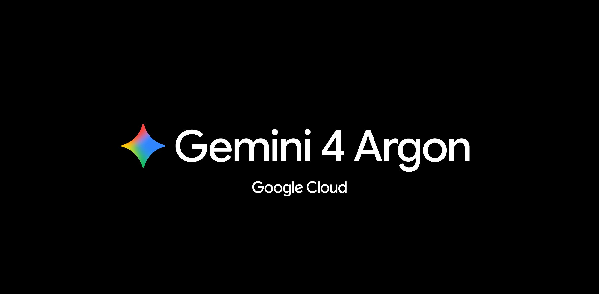

## TLDR

- **Google's Gemini 4 Argon reset frontier task pricing below two dollars:** topping public reasoning benchmarks while developer evals exposed a sharp split between raw intelligence and harness execution.
- **AWS capacity is spoken for through 2028:** Ben Horowitz says Andy Jassy told him so, as secondary debt yields on neoclouds spike under rising borrowing costs.
- **Runaway agent loops trigger five-figure bill shock:** disclosures from LangChain and Ramp show autonomous query amplification is overwhelming per-token price deflation without harness-level meters.
- **Our play:** deploy Gemini 4 Argon via direct APIs for greenfield builds, hedge neocloud counterparty risk with stepped accelerator reservations, and gate agent loops with DiffusionGemma on Cloud Run.

## The Big Picture: Agent Infrastructure & The Physical Compute Wall

### Gemini 4 Argon Resets Frontier Pricing at $1.99, but Exposes the Harness Chasm

Google launched Gemini 4 Argon globally, resetting frontier economics [Google Cloud (1 min read)](https://cloud.google.com/blog/products/ai-machine-learning/gemini-4-argon-available-on-google-cloud/). Argon topped Scale AI's reasoning benchmark at 55.4% ahead of GPT-6-Astra [Scale AI Labs (1 min read)](https://x.com/ScaleAILabs/status/2110455008450040176) and hit 97.5% on ARC-AGI-3 [ARC Prize (1 min read)](https://x.com/arcprize/status/2110768289861317026). Tomasz Tunguz calculates that TPU co-design lets Google price Argon at $1.99 a task—67% below Opus 5.5 and 74% below Fable 5.1 [Tomasz Tunguz (2 min read)](https://x.com/ttunguz/status/2110445394845127086).

Yet builder evals revealed an acute divergence between raw intelligence and execution harnesses. On Every's Senior Engineer refactoring benchmark, Argon scored just 21% on messy legacy code, closing self-verification steps in 30 milliseconds without inspecting changes [Dan Shipper on AI & I (52 min watch, 01:10)](https://www.youtube.com/watch?v=RbUHf4HeBzo) and [Dan Shipper (2 min read)](https://x.com/danshipper/status/2110038834205409332). Nathan Labenz explained on The Cognitive Revolution why benchmark leadership was not enough to displace his Claude and OpenAI pipelines: raw capability gains no longer outweigh switching risk and operational trust [Nathan Labenz on The Cognitive Revolution (86 min watch, 35:00)](https://www.youtube.com/watch?v=F1GDX_G9Bhw). Compounding the friction, developers reported Google's desktop Antigravity harness lags Claude Code and Codex by six to twelve months, prompting teams to bypass the desktop app entirely for raw endpoints [AI Daily Brief (31 min listen, 28:45)](https://podcasters.spotify.com/pod/show/nlw/episodes/What-Gemini-4-Argon-Is-Actually-Good-For-e3qguhf).

**Your angle with founders**

- **What they'll say:** "Argon flunked Every's refactoring bench, and Antigravity isn't ready for daily engineering." Grant both immediately: Argon struggles to untangle legacy codebases, and the desktop harness is still catching up to Claude Code.
- **The reframe that holds:** benchmark-maxing a single primary model is obsolete. Top engineering teams treat models as specialized workers, routing long-form writing, greenfield scaffolding, and 1M-token background jobs to Argon at a steep discount to Claude Opus.
- **The question to leave behind:** "Is your architecture tied to a single desktop harness, or can you route background tasks to a model that delivers frontier reasoning at two-thirds below Opus?"
- **Where GCP wins:** Gemini Enterprise Agent Platform (FKA Vertex AI) serves Gemini 4 Argon alongside Claude and open weights behind a unified API, letting founders consume Argon's server-side background execution without waiting for desktop app parity.

### The 2028 Compute Wall Meets the Neocloud Debt Squeeze: AWS Sells Out as CoreWeave Debt Spikes

The compute crunch has pushed past 2027. On All-In, Ben Horowitz said Amazon CEO Andy Jassy told him AWS capacity is committed through "end of 2028, maybe" [Ben Horowitz on All-In (95 min watch, 14:20)](https://www.youtube.com/watch?v=_b3LfMflIGs). Yet startups hoping neoclouds can absorb hyperscaler spillover met a sudden debt-market reckoning. Secondary yields on CoreWeave debt surged to 15%, with credit default swaps at 953 basis points implying a 55% five-year default probability [Chamath Palihapitiya on All-In (95 min watch, 07:45)](https://www.youtube.com/watch?v=_b3LfMflIGs), as its unsecured bonds dropped to 80 cents on the dollar [HedgieMarkets (2 min read)](https://x.com/HedgieMarkets/status/2110464014379540954). With CoreWeave still needing to raise another $35B in debt to build out signed commitments, analysts warn that 9% borrowing rates are colliding with 5% asset yields [AI Daily Brief (31 min listen, 18:30)](https://podcasters.spotify.com/pod/show/nlw/episodes/How-the-Latest-AI-Leap-Is-Disrupting-Business-Models-e3qiqv8).

Meanwhile, the physical costs of expansion are compounding. Jensen Huang noted that modern gigawatt clusters now cost $40B+ to build—up from $18B–20 billion—due to severe bottlenecks in substation power, land, and packaging [Jensen Huang on BG2 Pod (100 min watch, 52:10)](https://www.youtube.com/watch?v=eS7qQ3WJSrw). Training demand shows zero slack: SemiAnalysis data reveals inference accounts for only ~37% of total compute [Pradeep K (1 min read)](https://x.com/pradeeepk/status/2111587556416766136), while lab allocations like Anthropic's multi-gigawatt buildouts consume forward capacity [Jeff Pu (1 min read)](https://x.com/sssjeffpu/status/2109855992846696879).

**Your angle with founders**

- **Say what is true first:** Google Cloud is supply-constrained too. Every hyperscaler is rationing capacity; never pitch GCP as the overflow for Amazon's waitlist.
- **Inspect their counterparty risk.** If a founder signed a multi-year compute commitment with a debt-financed neocloud, ask what happens to their reservation if creditor covenants trigger an asset restructuring.
- **Decompose workloads by silicon fit rather than chip brand.** Training frontier models demands raw GPU clusters, but steady-state inference and offline batch processing can shift to custom silicon, bypassing the Nvidia allocation bottleneck entirely.
- **Where GCP wins:** balance-sheet durability paired with accelerator optionality. Rather than locking into inflexible take-or-pay debt contracts, founders can step into capacity through 90-day Calendar mode reservations on TPUs and GPUs, scaling into one- or three-year committed use discounts as production stabilizes.

### The $40,000 Agent Loop: Runaway Multi-Turn Bills Force Harness Metering and Semantic Routing

Per-token price cuts are masking an operational crisis: autonomous retry loops are compounding token consumption faster than inference prices can deflate. On 20VC, LangChain CEO Harrison Chase revealed his team burned $40,000 in one week on a single unmonitored agent loop that repeatedly captured and transmitted full-page DOM snapshots during front-end tasks [Harrison Chase on 20VC (64 min watch, 41:30)](https://www.youtube.com/watch?v=1jDCPEHwQfI). Ramp CEO Eric Glyman shared a similar shock, disclosing that Ramp burned $1.5M in tokens in a single week before building Glass and implementing project-level meters with Ramp Router, which slashed bills 30% [Eric Glyman (4 min read)](https://x.com/eglyman/status/2110007713396613568).

The root issue is architectural: a standard user prompt triggers a single API call, but autonomous agents run dozens of recursive tool calls underneath. Chase emphasized that routing must live inside the execution harness rather than at an external API gateway so agents can monitor state and preserve prompt caches [Harry Stebbings (1 min read)](https://x.com/HarryStebbings/status/2111535701682458961). To curb this amplification, builders are deploying lightweight gates like Google's open-weights DiffusionGemma to resolve routing decisions at a fraction of a cent instead of paying frontier rates [Google Cloud Tech (8 min read)](https://x.com/GoogleCloudTech/status/2109720569013055704).

## Quick Hits

- **[Ineffable Intelligence anchors GCP's largest open GPU cluster (69 min watch)](https://www.youtube.com/watch?v=L4SWQebqhek)** — David Silver and Lasse Espeholt selected Google Cloud's rack architecture for Ineffable's 20-person lab to run multi-agent simulations consuming up to 100,000x more compute than legacy reinforcement learning.
- **[Microsoft trains MAI Base 2 at one-quarter the compute of GPT-5.6 Sol (30 min listen)](https://podcasters.spotify.com/pod/show/nlw/episodes/The-Most-Important-AI-News-This-Week-Is-Getting-Overlooked-e3qk74e)** — Mustafa Suleiman announced Microsoft used 16,000 GB200 GPUs across 38 days to pre-train a foundation model powering Azure Frontier Tuning.
- **[REA reaches 127k GitHub stars as clean-room agent workflows deconstruct SaaS (7 min read)](https://x.com/ArchiveExplorer/status/2111083580524822707)** — The open-source reverse-engineering harness pairs binary decompilation with role-split agents to recreate commercial software features without inheriting copyrighted source code.
- **[Anthropic adds OpenTelemetry tracing to Claude Platform (1 min read)](https://x.com/ClaudeDevs/status/2110421732029063352)** — The Messages API, Managed Agents, and Claude SDKs now emit native OpenTelemetry traces directly into enterprise observability pipelines.

## Seller's Edge: The Harness Is the Switching Barrier, Not the Model

Edition #17 taught that models commoditize while the substrate endures, and Edition #23 showed that agentic cost is engineered through harness design. This week reveals where customer lock-in actually lives. When Google launched Gemini 4 Argon, builders praised its reasoning but bypassed Antigravity to call raw APIs because the desktop harness lacked cloud environments and browser orchestration [Dan Shipper on AI & I (52 min watch, 01:10)](https://www.youtube.com/watch?v=RbUHf4HeBzo). On 20VC, Harrison Chase explained why: if an agent's memory, state persistence, and tool schemas are coupled to a single provider's proprietary conventions, the founder cannot migrate [Harrison Chase on 20VC (64 min watch, 09:15)](https://www.youtube.com/watch?v=1jDCPEHwQfI).

Consider a founder spending $60,000 a month on Claude Opus who wants to route high-volume background extraction to Gemini 4 Argon to capture its lower task rate. If their agent harness hardcodes Anthropic tool-use schemas, bespoke message formatting, and provider-specific prompt-cache boundaries, capturing those savings stalls out. What should have been an API parameter update turns into an eight-week engineering overhaul because state, memory, and orchestration were glued to the model. The intelligence was swappable; the harness was not.

Stop debating which lab holds the benchmark crown. In your next meeting, ask: *"If a rival drops a model next Tuesday that cuts your inference cost in half, does capturing that margin require a routing config change, or does it break your agent's memory bank and execution state?"* Guide founders to decouple their harness from model weights, ensuring every frontier price cut flows straight to gross margin.

## Our Play

This edition's three threads point to one GCP position: **Google Cloud is the durable substrate where founders decouple harnesses from models, commit to compute on survivable terms, and govern agent spend—through three concrete motions:**

- **Route frontier tasks across Model Garden.** *Signal:* Founders want Argon's task pricing for greenfield work while keeping Claude for legacy refactoring. *Why GCP wins:* Model Garden serves Gemini and Claude side by side on the Agent Platform. *The move:* Benchmark their top background endpoint, then route greenfield and batch runs to Argon.
- **Hedge counterparty risk with stepped accelerator terms.** *Signal:* Neocloud debt distress puts founders' reservations at counterparty risk. *Why GCP wins:* Balance-sheet durability plus TPU and GPU optionality. *The move:* Map each workload to the accelerator that fits it, and size commitments to proven demand.
- **Halt runaway agent loops with DiffusionGemma hesitation gates.** *Signal:* Unchecked agent loops compound token spend. *Why GCP wins:* Open-weights DiffusionGemma on Cloud Run GPUs routes decisions at cents per thousand. *The move:* Gate heavy tool calls, escalating to Gemini Flash only when uncertainty is high.

---

*Sources: 138 bookmarks, 41 lab announcements, 41 podcast episodes from the AI content library. [Archive](/archive)*