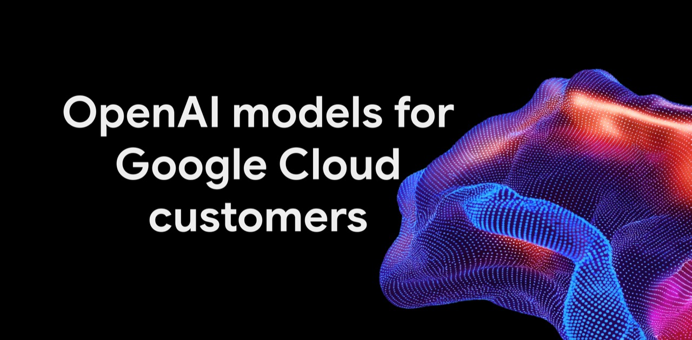

## TLDR

- **All three frontier labs now sit on one Google Cloud bill:** OpenAI models arrived in Model Garden (private preview) and Claude added an Anthropic-managed option, both drawing down existing commitments, as Replit flips its default model on price.
- **Black October put security first in line:** Wiz co-disclosed PHP2Shell as exploit attempts hit the millions, Railway says attackers may have taken decrypted customer secrets, and CrowdStrike's CEO calls security "the gas pedal, not the brake."
- **Last week's capacity wall became a contract fight:** Pichai says "everyone is short," and the real price gap between clouds is contract length, not brand.
- **Our play this week:** run one eval across three labs under one commitment, turn PHP2Shell into an exposure review, and size a first commitment step.

## The Big Picture: Model Share, Security, and the Contract

### All Three Frontier Labs, One Bill: OpenAI Lands in Model Garden as Builders Route by Price

On October 21, OpenAI's GPT-6 Astra, GPT-6.1 Sol and GPT-6 Luna arrived in Google Cloud's Model Garden, in private preview for select enterprise customers [Google Cloud (3 min read)](https://cloud.google.com/blog/products/ai-machine-learning/google-cloud-brings-openai-models-to-customers/). Google now calls itself the only hyperscaler offering all three leading closed models. The detail that matters to sellers: OpenAI usage lands on one Google Cloud invoice and draws down existing commitments. On October 23, Google made an Anthropic-managed Claude option generally available alongside the Google-managed one, with day-zero Claude platform features at the same pricing and billing [Google Cloud (3 min read)](https://cloud.google.com/blog/products/ai-machine-learning/expanding-claude-availability-on-google-cloud/).

Builders already route by price. On *20VC*, Jason Lemkin said Replit flipped its default from Claude Opus and Fable to OpenAI's Astra because Amjad Masad sees "peer level" quality at a price "30 to 40% better" — a new default, not a breakup, since Replit still routes across models [Jason Lemkin on 20VC (60 min watch, 23:25)](https://www.youtube.com/watch?v=OJX2L21e4fA). Going the other way, [@bindureddy (1 min read)](https://x.com/bindureddy/status/2114464231441752152) is "swapping all our Sol and Sonnet workloads with Argon." **The takeaway: model loyalty is a default setting, and the cloud that hosts every candidate keeps the spend when the default flips.**

**Your angle with founders**

- **Concede what isn't exclusive.** Claude runs on other clouds too, and OpenAI models here are private preview for select customers. Don't sell access; sell one contract.
- **Ask:** "Which model is your default today, and what would make you switch it?" Replit's answer was price; the default is where the volume goes.
- **Eval on their workload, not a leaderboard.** Their top workload on Gemini, Claude and OpenAI, scored on cost per accepted task, not list price per token.
- **Where GCP wins:** the only hyperscaler with all three leading closed labs on one invoice. Every pick draws down the same commitment and counts toward Flexible Savings Plans across providers, so flipping the default never strands spend.

### Black October: PHP2Shell, Stolen Platform Secrets, and Security Becomes the Gas Pedal

On October 21, PHP and Wiz Research disclosed PHP2Shell, two critical flaws (severity 9.2) in the PHP runtime that allow unauthenticated remote code execution [Google Cloud (12 min read)](https://cloud.google.com/blog/products/identity-security/responding-to-core-php-vulnerabilities-cve-2026-109618-cve-2026-109619/). PHP sits behind roughly 70% of websites, and [@AISafetyMemes (2 min read)](https://x.com/AISafetyMemes/status/2113113711644737835) logged governments taking sites offline. Cloudflare CEO Matthew Prince described attempts rising to tens of thousands in the first 45 minutes, "and millions now" [Matthew Prince on AI Daily Brief (29 min listen, 18:00)](https://podcasters.spotify.com/pod/show/nlw/episodes/The-AI-vs-AI-Battle-for-the-Internet-e3qu3ad). Railway said an attacker may have obtained decrypted environment variables for some customers, in "a series of attacks recently targeting platform companies" to reach AI inference providers [Railway on AI Daily Brief (29 min listen, 21:30)](https://podcasters.spotify.com/pod/show/nlw/episodes/The-AI-vs-AI-Battle-for-the-Internet-e3qu3ad). And Axios reported banks finding unauthorized third-party AI agents in customer accounts, some taking actions "independent of user instructions" [@MadisonMills22 (1 min read)](https://x.com/MadisonMills22/status/2113251043173683683).

The buyers moved with it. CrowdStrike CEO George Kurtz: "it's not malware anymore, it's prompts" [George Kurtz on No Priors (46 min watch, 08:15)](https://www.youtube.com/watch?v=PST8yesYOSo), and "for the first time, security is the gas pedal, not the brake" (11:22). [@satyanadella (1 min read)](https://x.com/satyanadella/status/2112168320946634932) wants models treated as insider risks, with controls outside the model. **The takeaway: security is now the item that gates each AI rollout this quarter.**

**Your angle with founders**

- **Open with who found it.** Wiz, now part of Google Cloud, co-disclosed PHP2Shell, and Google says Gemini 4 Argon helped find it and validate the patch.
- **Concede what nobody sells.** Only the patch fixes it. Cloud Armor rules are "compensating controls," and Cloudflare and Palo Alto sell the same virtual patch.
- **Ask:** "Can you list every place PHP runs in your stack, including vendor admin panels, and which ones face the internet?"
- **Where GCP wins:** Wiz flags vulnerable PHP without agents, catches exploitation at runtime, and offers patched WizOS PHP images free for 60 days. Cloud Armor managed rules covered enforcing customers automatically, and Mandiant added 23 detections. None of it replaces the patch.

### Commit Like a Lab: Last Week's Capacity Wall Turns Into a Contract-Terms Fight

Last edition, Ben Horowitz relayed that AWS capacity is committed through 2028. This week Andy Jassy said it himself [Andy Jassy on a16z Podcast (61 min watch, 25:10)](https://www.youtube.com/watch?v=-YMMRQ1qscI), and Sundar Pichai conceded "everyone is short—not just us" [@firstadopter (1 min read)](https://x.com/firstadopter/status/2112609917127590040). The new development is how buyers respond. The labs commit early: [@ttunguz (2 min read)](https://x.com/ttunguz/status/2112203752887443624) puts Anthropic's data center commitments at $518B, nearly 8x its $67B Q3 run rate.

And price follows term length. SF Compute's Evan Conrad calls the hyperscaler premium "an illusion": on-demand runs "$11 or $15 an hour" at a hyperscaler, while neoclouds mostly sell discounted reserved contracts [Evan Conrad on The Cognitive Revolution (89 min watch, 46:43)](https://www.youtube.com/watch?v=ZLgvW9rqdTM). That paper is heavy: U.S. neoclouds typically take 20-30% upfront, per an expert call shared by [@RihardJarc (2 min read)](https://x.com/RihardJarc/status/2112562002958692392), and [@chamath (1 min read)](https://x.com/chamath/status/2114402667082752044) calls their penalty clauses "the final boss battle." Meanwhile Ramp data shows corporate token-spend growth fell from 42% in July to 0.2% in September [@kurtsaltrichter (1 min read)](https://x.com/kurtsaltrichter/status/2112538842762727694), and Chamath says "1% of companies represent 90% of AI spending" [Chamath Palihapitiya on All-In (104 min watch, 02:28)](https://www.youtube.com/watch?v=6czo-C3FU7I). **The takeaway: the commit conversation is about term length and finding the 1% who actually spend.**

## Quick Hits

- **[90% of enterprises rolled out Claude or Codex, but only ~5% run agents for non-engineering work (44 min watch, 21:20)](https://www.youtube.com/watch?v=Vki6cklFqxo)** — Tenex's Alex Lieberman, of the ~100 enterprises he talks to; CISOs lack "a control panel for data permissioning."
- **[Google Cloud announced Agent Compute Engine, single-tenant micro-VMs for agents (2 min read)](https://x.com/BR_zone/status/2114186075174269250)** — It already runs Gemini's own agents; customers get a preview "in the coming months."
- **[Mistral plans to open-weight Mistral Large 4, a 1-trillion-parameter model (80 min watch, 38:08)](https://www.youtube.com/watch?v=nxAoCPsGfe8)** — Pierre Stock says the weights ship into customer tenants, trained on 3,800 Grace Blackwell GPUs.
- **[Anthropic opened a research preview of Claude Duet, a proactive agent app (1 min read)](https://x.com/claudeai/status/2112984664256241837)** — It works on background tasks and asks before consequential actions.

## Seller's Edge: Reference-Architecture Literacy: Decouple the Brain from the Hands

Edition #35 established that the harness is the real switching barrier. This week exposed the fault line inside it: the separation between orchestration state (the "brain") and runtime execution (the "hands"). LangChain's internal agents use this split: the orchestrator manages identity, memory, and scheduled jobs, while code runs in a sandbox behind a secret proxy [Harrison Chase (5 min read)](https://x.com/hwchase17/status/2114041443836903662).

Consider what happens when a team conflates the two. Builders prototype agents on laptops or flat Docker containers where the orchestrating model shares the filesystem and environment variables. Railway's breach shows the cost: environment variables are where API keys and database credentials live. If an agent executing bash commands holds production keys in memory, any prompt injection or poisoned package can exfiltrate them. A sound reference architecture decouples the brain from the hands: the agent reasons off-machine, while tools execute in an isolated sandbox that holds zero secrets, the rule Google set for Agent Compute Engine.

In your next founder meeting, skip the GPU count. Sketch the execution boundary on the whiteboard and ask: *"When your agent runs untrusted code or third-party tools, are your credentials sitting in the execution sandbox where an injected prompt can read them, or is your runtime zero-secret by design?"*

## Our Play

The through-line: **one commitment for every frontier model, containment you can prove, and capacity bought in steps.**

- **Run one eval across three labs, under one commitment.** *The move:* Request OpenAI private-preview access through Google's interest form, set up their top workload on Gemini, Claude and OpenAI in Model Garden on the Gemini Enterprise Agent Platform (FKA Vertex AI), and price the winner against their commitment.
- **Turn PHP2Shell into an exposure review.** *The move:* With their security lead, run a Wiz or Security Command Center exposure scan, confirm Cloud Armor managed rules are enforcing, and book a patch-verification follow-up.
- **Size the first commitment step.** *Signal:* Capacity is short everywhere, Google included, and term length sets price. *Why GCP wins:* Calendar mode books GPU or TPU blocks of up to 90 days with no CUD (TPU blocks are allowlisted), then CUDs; for model serving, Provisioned Throughput's 1-year plan is 26% below 1-month. *The move:* Split 90 days of bills into steady and bursty, and commit only the steady part.

---

*Sources: 88 bookmarks, 67 lab announcements, 47 podcast episodes from the AI content library. [Archive](/archive)*
