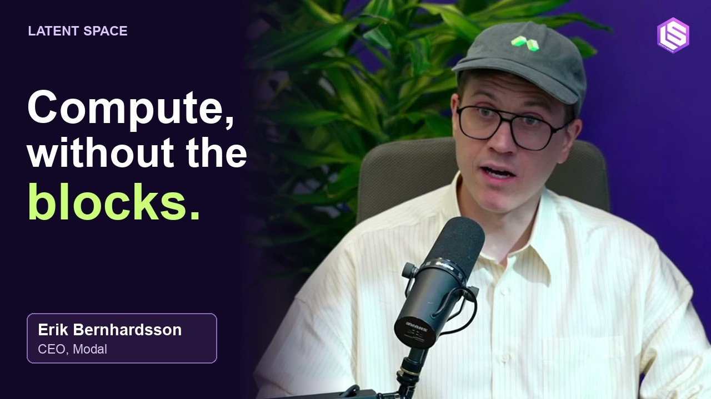
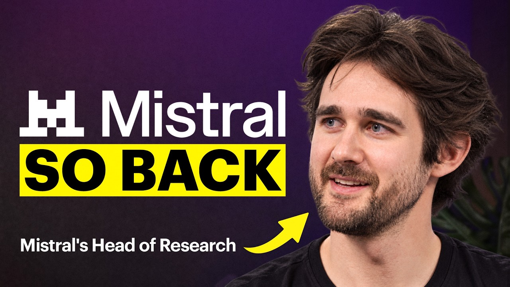

## TLDR

- **Agents are migrating off developer laptops into cloud micro-VMs:** as prompt scaffolding moves into model weights, execution is shifting to hardware-isolated sandboxes with zero credentials to eliminate exfiltration risk.
- **The compute crunch has turned into a debt-underwriting squeeze:** rigid 3-year GPU contracts mismatch bursty, sub-minute agent workloads, while OpenAI diversifies onto AWS Trainium custom silicon.
- **Mistral drops a 1-trillion parameter open model as banks repatriate workloads:** enterprises demand inspectable reasoning chains without API lock-in, yet building custom on-prem data centers hits severe hardware backlogs.
- **Our play this week:** replace vulnerable local execution with Agent Compute Engine micro-VMs, avoid neocloud debt covenants via quarterly reservation terms, and deploy open weights in-tenant on Model Garden.

## The Big Picture: Agent Infrastructure & The Compute Financing Trap

### The Agent Moves Off the Laptop: Hardware-Isolated Micro-VMs and the Death of the Local Harness

In Edition #35, agent harnesses triggered runaway retry loops. This week, the operational substrate flipped. At the AI Engineer Summit, Jediah Katz (SpaceXAI, formerly Cursor's longest-tenured harness engineer) predicted that 90% of agent workloads will migrate off developer laptops within six months [Jediah Katz on AI Engineer (18 min watch)](https://www.youtube.com/watch?v=7Y4sbZgBdnc). As models absorb prompt scaffolding, the harness's value shifts to infrastructure and trust. [@cherry_mx_reds (1 min read)](https://x.com/cherry_mx_reds/status/2113969070118666670) highlighted Anthropic guidance to fold subagents into single loops, concentrating execution risk.

That concentration proved toxic locally. The "Black October" cyber surge saw Railway leak customer API keys [Railway on AI Daily Brief (29 min listen, 21:30)](https://podcasters.spotify.com/pod/show/nlw/episodes/The-AI-vs-AI-Battle-for-the-Internet-e3qu3ad), while major US banks detected rogue agents attempting unauthorized transactions [Madison Mills on Axios (1 min read)](https://x.com/MadisonMills22/status/2113251043173683683). Microsoft CEO Satya Nadella urged treating agents as insider risks [Satya Nadella (1 min read)](https://x.com/satyanadella/status/2112168320946634932), and Palo Alto Networks CEO Nikesh Arora warned that unmonitored harnesses expose enterprises to backdoors [@nikesharora (3 min read)](https://x.com/nikesharora/status/2114372350707986492).

To counter the threat, [@rseroter (1 min read)](https://x.com/rseroter/status/2113331802647449803) highlighted Agent Compute Engine micro-VMs combining hardware isolation with container speed [Google Cloud (22 min read)](https://cloud.google.com/blog/topics/ai-infrastructure/agent-compute-engine-deep-dive/), while [@hwchase17 (5 min read)](https://x.com/hwchase17/status/2114041443836903662) shared the LangChain harness architecture using secret-swapping proxies. Local execution gave agents root access to unencrypted keys; production demands ephemeral, zero-credential micro-VMs.

**Your angle with founders**

- **Concede what nobody sells.** No cloud vendor prevents prompt injection from hijacking agent intent. What you can buy is blast-radius containment and evidence; claim prevention and their security lead tunes out.
- **Run three checks.** Ask: "When subagents execute tools, do their credentials touch the runtime sandbox where prompt injection can reach them?" Then check for one shared service account and for shared containers instead of isolated kernels.
- **Contain at the runtime layer.** Prompt inspection catches known leaks, not a hijacked agent. The structural defense is per-agent identity, an isolated kernel, and zero secrets in the sandbox, with an off-machine proxy injecting credentials.
- **Where GCP wins:** Agent Compute Engine gives every agent session its own single-tenant micro-VM anchored in Titanium, and idle agents checkpoint to near-zero cost. Say the limit out loud: it shrinks what a hijacked agent can reach; it does not stop the hijack.

### The Compute "Rectangle" Trap: Credit Covenants, 8-Second Sandboxes, and OpenAI's Trainium Pivot

The compute squeeze has shifted from power constraints into a financing bottleneck. On *The Cognitive Revolution*, SF Compute founder Evan Conrad revealed that lenders cannot value repossessed GPU clusters, demanding 100% upfront cash and punitive covenants from startups [Evan Conrad on The Cognitive Revolution (89 min watch, 00:01)](https://www.youtube.com/watch?v=ZLgvW9rqdTM). B300s rent for $5 to $6 an hour against $25 to $40 in inference revenue [Evan Conrad on Latent Space (37 min watch, 18:00)](https://www.youtube.com/watch?v=EAtLq9_vrE0), yet neoclouds still demand multi-year leases. Modal CEO Erik Bernhardsson called this the "3-year rectangle" trap: the median agent sandbox runs for just 8 seconds [Erik Bernhardsson on Latent Space (86 min watch, 79:30)](https://www.youtube.com/watch?v=IiZ9yd2Do8I).

Returns are tightening: [@kurtsaltrichter (1 min read)](https://x.com/kurtsaltrichter/status/2112538842762727694) cited Ramp data showing token spend growth slowing to 0.2%, while [@chamath (1 min read)](https://x.com/chamath/status/2114402667082752044) flagged neocloud offtaker damages risk and a stranded compute glut. On the *a16z Podcast*, Amazon CEO Andy Jassy confirmed AWS capacity is committed through 2028 and warned inference remains an order of magnitude too costly for enterprise rewrites [Andy Jassy on a16z Podcast (61 min watch, 22:15)](https://www.youtube.com/watch?v=-YMMRQ1qscI). Jassy also revealed OpenAI signed a multi-gigawatt commitment for AWS Trainium custom silicon. As [@firesidealpha (2 min read)](https://x.com/firesidealpha/status/2114329376628027755) noted, SemiAnalysis found custom silicon cuts gigawatt data center costs from $60B to $20B by eliminating merchant chip margins.

**Your angle with founders**

- **Concede the sticker price.** Discounted neocloud rates beat on-demand hyperscaler pricing. The catch is the paper: a 3-year take-or-pay contract with covenants.
- **Run the utilization math live.** Ask: "What percentage of your GPU hours actually process active tokens?" If the workload is bursty, sub-minute agent runs, a fixed 3-year block sits idle most of the day, and the real cost per useful hour climbs past the discount.
- **Decompose silicon by workload before signing long-term paper.** Frontier pre-training needs flagship GPUs, but production inference and batch pipelines thrive on custom silicon with predictable pricing, bypassing merchant chip premiums.
- **Where GCP wins:** Google Cloud breaks the rectangle trap with 90-day Calendar mode reservations on TPUs and GPUs, letting founders scale into committed use discounts as production stabilizes without balance-sheet debt covenants.

### The 1-Trillion Parameter Open Leap: Mistral Large 4, Chain-of-Thought Auditing, and the Repatriation Mirage

Open weights have reached the trillion-parameter frontier. On *The MAD Podcast*, Mistral AI unveiled Mistral Large 4 ("Le Chonk"), a 1-trillion parameter mixture-of-experts model trained on 3,800 Grace Blackwell GPUs to ship weights directly into customer tenants [Pierre Stock on The MAD Podcast (80 min watch, 39:30)](https://www.youtube.com/watch?v=nxAoCPsGfe8). On *All-In*, Palo Alto Networks CEO Nikesh Arora named the enterprise catalyst: open weights let them "interrogate the chain of thought," because enterprises will need explainability and auditability [Nikesh Arora on All-In (104 min watch, 13:15)](https://www.youtube.com/watch?v=6czo-C3FU7I). [@RihardJarc (2 min read)](https://x.com/RihardJarc/status/2112562002958692392) reported teams replacing frontier APIs with open weights in agent harnesses.

Yet repatriating workloads to private data centers hits severe operational walls. Chamath Palihapitiya revealed on *All-In* that a major bank built six ground-up data centers to slash cloud spend [Chamath Palihapitiya on All-In (104 min watch, 09:30)](https://www.youtube.com/watch?v=6czo-C3FU7I). Arora named the catch: at 99.9% reliability, it is very hard to find a global inference provider outside the hyperscalers. And on *Interconnects*, reactions to Moonshot's 3-trillion-parameter Kimi K3.1 Pro centered on serving cost: dedicated NVL72 racks and B300 nodes per replica [Nathan Lambert on Interconnects (47 min watch, 06:15)](https://www.youtube.com/watch?v=0xiq7RHVGRE). Meanwhile, [@googlecloud (1 min read)](https://x.com/googlecloud/status/2112952051386679720) open-sourced TorchTPU for native PyTorch on TPUs, lowering the switching cost for PyTorch teams weighing TPUs.

## Quick Hits

- **[Replit flips its default platform engine from Claude to OpenAI Astra for 30% to 40% savings (60 min watch)](https://www.youtube.com/watch?v=OJX2L21e4fA)** — Amjad Masad migrated Replit's default backend after benchmarking peer coding capability at a discount, highlighting gross margin pressure on developer platforms.
- **[Anthropic launched a research preview of Claude Duet for proactive background workflows (1 min read)](https://x.com/claudeai/status/2112984664256241837)** — The standalone application introduces autonomous personal agents that process background tasks continuously and request confirmation before taking consequential external actions.
- **[OpenAI released the Decisions API for high-speed classification and automated evaluations (9 min read)](https://x.com/HamelHusain/status/2112588257104216294)** — Evaluated on trace failure detection, OpenAI's new endpoints hit an 0.87 F1 score at 3.7 cents per 100 runs, undercutting full LLM judges.

## Seller's Edge: Reference-Architecture Literacy: Decouple the Brain from the Hands

Edition #35 established that the harness is the real switching barrier. This week exposed the fault line inside it: the separation between orchestration state (the "brain") and runtime execution (the "hands"). Jediah Katz's case is that the harness endures because it owns infrastructure, trust, and efficiency. LangChain codified this split across production agents: orchestrators manage identity, memory, and scheduled crons, while untrusted code executes in isolated sandboxes through mediated proxies [Harrison Chase (5 min read)](https://x.com/hwchase17/status/2114041443836903662).

Consider what happens when a team conflates the two. Builders prototype agents on local laptops or flat Docker containers where the orchestrating model shares the filesystem and environment variables. In this week's leaks, the common vulnerability was credentials sitting inside the execution space. If an agent executing bash commands holds production API keys in memory, any prompt injection or poisoned package can exfiltrate them. A sound reference architecture decouples the brain from the hands: the agent reasons off-machine, while tools execute in a hardware-isolated micro-VM where credentials never touch the guest kernel.

In your next founder meeting, stop asking about raw GPU counts. Walk to the whiteboard and sketch the execution boundary. Ask: *"When your agent runs untrusted code or third-party tools, are your credentials sitting in the execution sandbox where an injected prompt can read them, or is your runtime zero-secret by design?"* 

## Our Play

The through-line: **run agents in zero-secret sandboxes, buy compute in steps instead of 3-year blocks, and serve open weights in the customer's own tenant.**

- **Isolate agent execution with Agent Compute Engine.** *Signal:* Agents leaving laptops land in shared containers that hold credentials. *The move:* Audit where their agent code runs and what credentials it can read, then pilot one workflow on Agent Compute Engine with credentials injected by proxy.
- **Escape the 3-year rectangle with stepped accelerator terms.** *Signal:* Startups face rigid multi-year neocloud debt covenants for bursty, sub-minute agent workloads. *The move:* Decompose their pipeline, sizing steady-state inference onto TPU 8i and bursts onto Flex-start (Dynamic Workload Scheduler).
- **Eval open weights side by side on Model Garden.** *Signal:* Regulated enterprises want open models like Mistral Large 4 to audit reasoning chains without building private data centers. *Why GCP wins:* Model Garden on the Gemini Enterprise Agent Platform (FKA Vertex AI) puts open and closed models side by side in their own project. *The move:* Eval an open-weight model against their closed API on their workload.

---

*Sources: 88 bookmarks, 67 lab announcements, 18 podcast episodes from the AI content library. [Archive](/archive)*