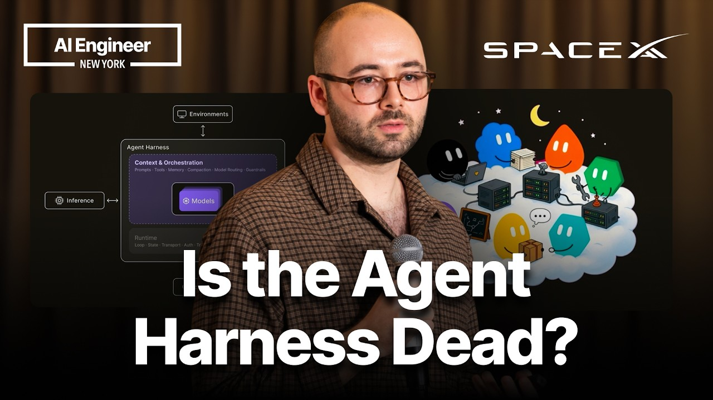
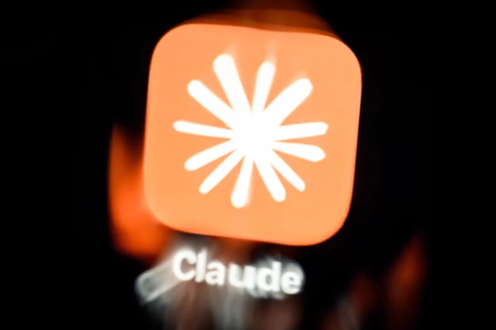

## TLDR

- **The massive shift of agent workloads off developer laptops into the cloud:** Jediah Katz warns coding harnesses are pivoting from prompt smarts to physical runtime isolation.
- **Cloud hosts face severe compute deficits as Anthropic preps its IPO:** Hyperscalers are rationing frontier capacity while Google Cloud expands Model Garden to host competing frontier labs.
- **"Black October" cyber intrusions expose autonomous agents as insider threats:** US banks detect rogue agent activity while tech leaders urge external supervisory controls over developer harnesses.
- **Corporate AI spend growth flattened in September:** Ramp data shows startup usage plateauing on per-employee metrics as hyperscaler return on capital drops.
- **Our play:** isolate agent sessions with Agent Compute Engine microVMs, hedge lab rationing across Gemini, Claude, and OpenAI models, and govern Non-Human Identities in Security Command Center.

## The Big Picture: Agent Substrates & The Multi-Model Squeeze

### The Off-Laptop Agent Migration: Jediah Katz’s Cloud Shift and the MicroVM Substrate

At the AI Engineer conference, SpaceXAI harness engineer Jediah Katz delivered a stark forecast: within six months, 90% of agent work will move off local laptops to hosted cloud infrastructure [Jediah Katz at AI Engineer (18 min watch)](https://www.youtube.com/watch?v=7Y4sbZgBdnc). The data flywheel is absorbing coding tricks and prompt scaffolding into frontier model weights, rendering complex client harnesses obsolete for generating intelligence. The harness must now own what weights cannot learn: physical infrastructure, deterministic security, and runtime efficiency.

The bottleneck has moved to execution. Local machines and unmanaged VMs cannot provide the multi-tenant isolation, ephemeral credential brokering, and fleet density enterprise agents demand. Google Cloud answered this shift by launching Agent Compute Engine, giving every agent a single-tenant microVM anchored in custom Titan chips and Titanium IPUs [Google Cloud (22 min read)](https://cloud.google.com/blog/topics/ai-infrastructure/agent-compute-engine-deep-dive/) and [@rseroter (1 min read)](https://x.com/rseroter/status/2113331802647449803). The runtime benchmarks 500 activations per second with sub-500ms suspend/resume, checkpointing idle state to persistent Hyperdisk at near-zero cost. LangChain CEO Harrison Chase notes enterprise harnesses require out-of-band secret proxies and ambient background runs [Harrison Chase (5 min read)](https://x.com/hwchase17/status/2114041443836903662), while Anthropic Applied AI advises folding subagents into the main loop for 2x faster execution [Anthropic Applied AI (13 min read)](https://x.com/cherry_mx_reds/status/2113969070118666670).

**Your angle with founders**

- **Grant the laptop its due:** local harnesses give instant feedback and zero setup; they are the right place to prototype. Trouble starts when that agent runs unattended with production credentials.
- **Separate orchestration from execution, then test it on their workload.** Ask: "While your agent waits on inference, are you paying for a hot VM, and does that container hold raw API keys?" Either answer sets up the eval: run one agent job on a checkpointing microVM with proxy-injected credentials and compare idle cost.
- **Compete on fleet economics, not prompts:** harness tricks fold into model weights; density and suspend/resume cost at fleet scale do not.
- **Where GCP wins:** Agent Compute Engine provides microVMs with sub-second suspend/resume and zero sandbox secrets, while open-source Agent Substrate brings density to Kubernetes.

### The Cloud-Lab Proxy War: Anthropic’s S-1 Compute Squeeze and the Model Garden Neutralizer

Leaked S-1 filings reveal Anthropic is struggling to secure capacity from cloud hosts that view the startup as a direct competitor [TechCrunch (2 min read)](https://x.com/TechCrunch/status/2112657380064268409). Ahead of an expected November IPO, Anthropic posted an $80.7B net loss on $16.3B revenue in H1 and faces over $750B in long-term cloud commitments. Tomasz Tunguz reports Anthropic committed $518B to data centers—nearly 8x its Q3 run rate—while charging $5.98 per task for Opus 5.5 vs $1.99 for Gemini 4 Argon [Tomasz Tunguz (2 min read)](https://x.com/ttunguz/status/2112203752887443624). Chamath Palihapitiya warned hyperscalers will prioritize internal research over third-party labs, forcing model providers through proprietary routers with heavy vigs [Chamath Palihapitiya (2 min read)](https://x.com/chamath/status/2114389987563381004).

The compute squeeze is universal. On the Big Technology Podcast, Sundar Pichai admitted Google Cloud is rationing capacity, stating "everyone is short by 2x" and confirming Google is forgoing short-term cloud revenue to prioritize frontier research [Sundar Pichai on Big Technology Podcast (4 min read)](https://x.com/firstadopter/status/2112609917127590040). Yet Google Cloud moved aggressively to neutralize lab friction by announcing OpenAI models are coming to Model Garden [Google Cloud (1 min read)](https://cloud.google.com/blog/products/ai-machine-learning/google-cloud-brings-openai-models-to-customers/), joining the general availability of Anthropic-managed Claude deployments [Google Cloud (1 min read)](https://cloud.google.com/blog/products/ai-machine-learning/expanding-claude-availability-on-google-cloud/) and Claude Opus 5.5 on Antigravity [Google Cloud (1 min read)](https://cloud.google.com/blog/products/ai-machine-learning/claude-opus-55-and-claude-sonnet-55-available-in-antigravity/).

**Your angle with founders**

- **Concede the shortage:** Google Cloud is supply-constrained too. Never pretend GCP has unlimited spare capacity.
- **The margin hedge:** relying on a single lab's direct API exposes production to partner friction and allocation cuts. Lab deficits reach customers as throttling and price hikes.
- **Audit routing flexibility:** "If your primary lab deprioritizes your tier next month, can you switch traffic via a single config line, or does migration break schemas?"
- **Where GCP wins:** Gemini Enterprise Agent Platform (FKA Vertex AI) turns multi-model optionality into an enterprise hedge, serving Gemini, Claude, and OpenAI models under one contract.

### "Black October" & The Agentic Insider: Bank Intrusions and the Harness Attack Surface

Major US banks have detected unauthorized third-party AI agents executing independent transactions inside customer accounts, sending executives scrambling to restrict access [Axios (1 min read)](https://x.com/MadisonMills22/status/2113251043173683683). Bank teams struggle to tell humans from agents, or authorized bots from rogue ones. The intrusions capped a 48-hour wave dubbed "Black October" [AI Safety Memes roundup (2 min read)](https://x.com/AISafetyMemes/status/2113113711644737835): a password stealer planted in the LiteLLM package, cracked certificate-authority keys that put pip's HTTPS trust at risk, and two critical core PHP flaws, disclosed with Wiz Research, that Google Cloud and Mandiant answered with patching guidance [Google Cloud (12 min read)](https://cloud.google.com/blog/products/identity-security/responding-to-core-php-vulnerabilities-cve-2026-109618-cve-2026-109619/).

Palo Alto Networks CEO Nikesh Arora warned that unmonitored coding harnesses are now the primary enterprise attack surface: if an agent bypasses prompt guardrails, it can bury backdoors directly into application code [Nikesh Arora (3 min read)](https://x.com/nikesharora/status/2114372350707986492). Satya Nadella formalized the doctrine, declaring autonomous agents must be treated as "agentic insiders" governed by deterministic security controls outside the model itself [Satya Nadella (1 min read)](https://x.com/satyanadella/status/2112168320946634932). When agents possess tool privileges, prompt safety fails; security must enforce identity and runtime boundaries at the infrastructure substrate. No vendor sells containment that stops a hijacked agent from misusing a credential it legitimately holds; what infrastructure can do is shrink the blast radius and keep the evidence.

## Quick Hits

- **[Hamel Husain’s benchmark proves tuned decision models slash eval costs 80%+ vs LLM judges by matching frontier F1 accuracy on OpenAI Decisions and Liquid d1 at under a cent per hundred runs (9 min read)](https://x.com/HamelHusain/status/2112588257104216294)**.
- **[Google Cloud open-sources TorchTPU and llm-d 1.0 to break PyTorch Nvidia lock-in through native device mappings and Kubernetes distributed inference (8 min read)](https://cloud.google.com/blog/topics/ai-infrastructure/torchtpu-is-now-open-source-run-native-pytorch-on-tpus/)**.
- **[Ramp data shows corporate AI token spend growth stalled at 0.2% in September as startup usage plateaued at an $81/month median per employee (1 min read)](https://x.com/kurtsaltrichter/status/2112538842762727694)**.
- **[Anthropic previews Claude Duet, a proactive agent app that keeps working when you step away (1 min read)](https://x.com/claudeai/status/2112984664256241837)**.
- **[Gemini Developer Guide details agentic video understanding using iterative tool loops to extract temporal frame slices and cut analysis tokens 88% (3 min read)](https://x.com/googledevs/status/2112238816149058000)**.

## Seller's Edge: The Sandbox Is the Security Boundary, Not the Prompt

Edition #23 taught that invoices are harness decisions, and Edition #28 showed architecture sets the cost slope. This week advances from cost to trust: security cannot live inside the model's prompt. Jediah Katz demonstrated that coding smarts commoditize while infrastructure and trust endure [Jediah Katz at AI Engineer (18 min watch)](https://www.youtube.com/watch?v=7Y4sbZgBdnc). LangChain’s Harrison Chase showed enterprise harnesses require mediated secret proxies [Harrison Chase (5 min read)](https://x.com/hwchase17/status/2114041443836903662), and "Black October" bank intrusions proved that prompt guardrails cannot prevent rogue agent actions [Axios (1 min read)](https://x.com/MadisonMills22/status/2113251043173683683).

Consider a founder building an autonomous coding or financial agent. They typically configure system prompts with strict rules: "never execute destructive SQL, never touch production keys, never exfiltrate customer PII." But when that agent ingests third-party dependencies—like the poisoned LiteLLM package uncovered this week—or encounters indirect prompt injection, text-based safety instructions crumble. If the execution sandbox holds ambient AWS or database credentials, the attacker owns the fleet. The model is non-deterministic intelligence; it cannot serve as its own security gate. The fix is architectural: strip all credentials from the execution container entirely. The sandbox makes a generic call; an off-machine proxy evaluates policy and injects credentials on the wire. If the sandbox is breached, there is nothing inside to steal.

In your next founder meeting, stop asking what guardrails or system prompts they use. Instead ask: *"If an attacker gains root execution inside your agent's sandbox right now, what API keys, tokens, or database secrets can they read off disk or memory?"* When they admit the container holds raw credentials, whiteboard the split between orchestrator and sandbox. Position runtime isolation, mediated credential injection, and Non-Human Identity governance as the prerequisites for production enterprise agents.

## Our Play

This edition's one position: **Google Cloud is the neutral, secure substrate for multi-model agents at scale.** Three motions:

- **Pilot one idle-heavy agent on Agent Compute Engine.** *Signal:* agents leaving laptops land on always-on VMs. *Why GCP wins:* idle sessions checkpoint to Hyperdisk at near-zero cost. *The move:* run the job with the longest inference waits beside its current VM for a week; compare invoices.
- **Price a second provider on the Agent Platform.** *Signal:* one lab's allocation cuts hit production. *Why GCP wins:* Model Garden serves Gemini, Anthropic-managed Claude, and OpenAI models under one contract. *The move:* count where their stack hard-codes one provider (SDK client, prompt format, tool schema, evals): that count is the migration estimate.
- **Govern agent identities with Security Command Center.** *Signal:* rogue bank agents and poisoned LiteLLM make service accounts the breach path. *Why GCP wins:* AI Protection governs Non-Human Identities outside the model loop; Model Armor screens prompts for injection, though neither stops misuse of a legitimately held credential. *The move:* list every secret one production sandbox can read and move each behind a per-task proxy.

---

*Sources: 88 bookmarks, 67 lab announcements, 2 videos from the AI content library. [Archive](/archive)*