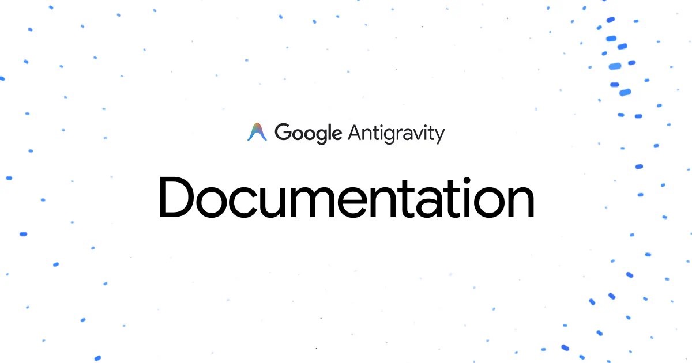
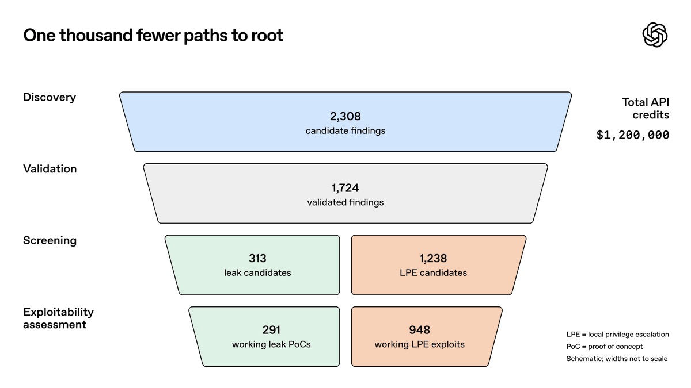

## TLDR

- **Always-on agents are breaking SaaS margins:** Google moved Antigravity's coding agents into cloud VMs the same week Jason Lemkin asked how persistent agents can pencil out on a consumer subscription.
- **AI is speeding up attackers and defenders alike:** OpenAI's pipeline found and patched Linux kernel zero-days by the hundreds, yet the week's worst breach was one stolen Fireworks API key that cascaded through Cursor.
- **Voters and lenders both turned on data centers:** 41 of 42 anti-data center ballot measures passed and lenders stopped bidding on GPU debt, so startups renting from debt-funded providers inherit their construction risk.
- **Our plays this week:** Audit idle agent hours and move state off always-on VMs, give each agent its own identity before the next key leak, and size GPU commitments in steps.

## The Big Picture: Runtimes, Autonomous Cyber, and Physical Gridlocks

### The Agent Runtime Split: Antigravity Moves to the Cloud and the Idle-VM Margin Trap

Agents stopped needing you at your desk, and that changes what they cost: agent infrastructure's question is no longer whether an agent can keep its state, but who pays for the machine while it does. Google moved coding agents into the cloud with [Cloud Remote Agents in Google Antigravity (9 min read)](https://x.com/antigravity/status/2118530674940326368): tasks run in cloud VMs that keep working while the laptop sleeps [@StatsWire (1 min read)](https://x.com/StatsWire/status/2118003279502152147). Replit expects its users to go from 10 agents to 10,000, Amjad Masad said on [*Lightcone* (45 min watch, 33:20)](https://www.youtube.com/watch?v=Q78dJ0vkWe8).

That moves the bill. Jason Lemkin said on [*20VC* (69 min watch, 23:45)](https://www.youtube.com/watch?v=4nKt18AZDsQ) that persistent agents cost "more than 20 bucks a month" per user, a hard fit on a $30 or $40 plan, while the tuned on/off VMs behind Replit and Lovable run "about 4 to five bucks." The fix splits memory from machine: DeepSeek open-sourced a [Super-agent system architecture (30 min read)](https://x.com/DeepSeekHarness/status/2116857257245987236) in which one central node dispatches work to shared execution nodes [@Layton_Gott (5 min read)](https://x.com/Layton_Gott/status/2116903774627201507), and sandbox maker Daytona says the infrastructure for this scale "does not exist" [Ivan Burazin on The Peel (119 min listen)](https://podcasters.spotify.com/pod/show/turner-novak/episodes/How-Daytona-Went-1M-to-100M-ARR-in-4-Quarters--Ivan-Burazin-e3rqjsp). The takeaway: an agent's cost is set by how long its machine stays on, not how hard it works, so the platform that bills for the work wins agent workloads.

**Your angle with founders**

- **The conversation to skip:** Debating seat price before knowing how long their agent machines sit idle.
- **The decomposition to run live:** Split their hosting bill into hours spent executing tool calls and hours spent waiting. The waiting hours are the margin leak.
- **The question to leave behind:** "If active users 10x next month, does your hosting cost grow with the work your agents do, or with the hours they sit idle?"
- **Where GCP wins:** Agent Runtime on the Gemini Enterprise Agent Platform (FKA Vertex AI) keeps long-running agent state in Sessions and Memory Bank with sub-second cold starts, and teams on Kubernetes get the same pattern from [Agent Substrate on GKE (6 min read)](https://cloud.google.com/blog/products/containers-kubernetes/open-infrastructure-for-autonomous-agents-comes-to-cncf/), which snapshots idle agents and restores them in under 500 milliseconds.

### Autonomous Cyber Shock: OpenAI's Kernel-Bug Pipeline, GPT-6 Cyber, and a Stolen-Key Cascade

AI is speeding up attackers and defenders at once, which makes breaches a question of containment, not prevention. On November 4, OpenAI said its autonomous pipeline [validated and generated patches for 948 local privilege-escalation zero-days in the Linux kernel (1 min read)](https://openai.com/index/a-thousand-fewer-paths-to-root) for $1.2M in API tokens [@OpenAI (1 min read)](https://x.com/OpenAI/status/2118119451401048497), and a day later it released [GPT-6 Cyber (1 min read)](https://openai.com/index/introducing-gpt-6-cyber). Attackers are moving as fast, with a new unauthenticated flaw in [React Server Components (1 min read)](https://x.com/UpwindMDR/status/2119417127874519107) and takeovers of unpatched Linux servers through [MPTCP (1 min read)](https://x.com/alive_/status/2116902936185889188).

Yet the week's worst breach was ordinary. Alex Stamos described on [*Decoder* (61 min watch, 04:30)](https://www.youtube.com/watch?v=75kjtoOpFlo) how API keys stolen from Fireworks were used to break into Cursor, which then pushed a bad plugin that reached "5,000 more companies." The takeaway: the weakest point in an AI stack is the shared credential, and enterprise buyers will ask a founder how far one stolen key can reach. Google Cloud's controls answer that question.

**Your angle with founders**

- **Say what is not on offer first:** No vendor, Google included, stops a stolen key or malicious plugin from reaching production. Sell a smaller blast radius and evidence.
- **Audit blast radius in their stack:** If an upstream key leaks tomorrow, which agents hold it, and what production systems can they reach?
- **Name products against boundaries, limits included:** Agent Identity gives each agent its own identity: its Google Cloud tokens only work inside its own runtime, and its auth manager vaults third-party API keys for one-step revocation. GKE Sandbox isolates model-written code from the host kernel. Model Armor screens prompts but does not decode encoded content.
- **Where GCP wins:** Wiz maps the blast radius across every cloud they run on, and Mandiant evidence answers the security questionnaire. Google has no GPT-6 Cyber equivalent, so propose a multi-model code review: Gemini, another commercial model, and an open model.

### The Local Revolt Against Data Centers: Ballot Losses, a GPU Debt Freeze, and Hyperscalers Absorbing Sites

Whether a data center gets built now depends on voters and lenders as much as on chips, and startups renting GPUs inherit that risk. Scott Galloway said on [*Pivot* (72 min watch)](https://www.youtube.com/watch?v=tj5OeuTJvUg) that "41 of 42" anti-data center ballot measures passed, and Texas began pausing and reviewing proposed projects [AI Daily Brief (25 min listen)](https://podcasters.spotify.com/pod/show/nlw/episodes/How-the-Midterm-Results-Change-AI-e3rotli). Ben Thompson tied the backlash to utility bills and grid strain on [*Sharp Tech* (102 min listen, 10:15)](https://sharptech.fm/member/episode/america-votes-against-data-centers-implications-for-big-tech-and-beyond-were-google-bears-right-all-along).

The money is tightening too. "You want to go raise multi-billion dollar debt for GPUs? No bid," Jamin Ball said on [*Latent Space* (103 min watch, 01:18:20)](https://www.youtube.com/watch?v=P735f1xlpL0), and Casado told [*Invest Like the Best* (66 min listen, 37:45)](https://colossus.com/episode/the-productive-investor/) that borrowers below investment grade are "running out of available debt." Meanwhile Google took over a Crusoe data center [Chamath Palihapitiya on All-In (94 min watch, 59:30)](https://www.youtube.com/watch?v=2v8b062QzTI).

What it means: when a provider that borrows to build slips, its customers' capacity dates slip too. Google Cloud's balance sheet doesn't depend on lenders, but capacity is tight here too, so the pitch is commitment terms, never "we have more." Founders should ask what their compute contract says if the build is late.

## Quick Hits

- **[Revolut moved about 2,000 engineers onto self-hosted GLM running on 56 B200s (1 min read)](https://x.com/guilleflorvs/status/2117379073785696395)** at roughly 30 cents per million tokens, about a tenth of its previous spend.
- **[Jamin Ball called Anthropic "almost accidentally profitable" after reading its S-1 (103 min watch)](https://www.youtube.com/watch?v=P735f1xlpL0)**: serving compute rose 2.3x while revenue rose 14x, and 80% of revenue came from models six months old or younger, so the newest model is the product.
- **[fal raised $1.65B across its Series E and F, led by Sequoia and Bessemer (64 min watch)](https://www.youtube.com/watch?v=pPzJ1wE8Lnw)**, and founder Burkay Gur said a single coding-agent power user can spend $10,000 to $20,000 a month on inference.

## Seller's Edge: Persistence Is a State Problem, Not a Compute Problem

When founders hear "always-on agent," they rent an always-on machine. An agent needs two things that behave differently: memory, which has to persist, and compute, which is only needed while the agent is executing a step. Put both in one machine and you pay for compute around the clock just to keep memory alive. Split them, with memory in storage and compute that starts only when there is work, and the bill follows the work instead of the clock.

Worked example: take a founder selling a consumer agent on a flat monthly plan. Their agent makes tool calls for perhaps two hours a day, but its machine runs all 24. That is about 8% utilisation, or twelve hours paid for every hour of work. DeepSeek's open-sourced Super-agent design shows the other shape: a central node hands work to shared execution nodes, so capacity serves many agents instead of sitting pinned to one user. The split does not make each hour cheaper. It removes most of the hours, which is why Lemkin's tuned on/off VMs cost a fraction of persistent ones.

The behavior change: in your next architecture review with an agent startup, look at the hosting bill before you discuss model pricing, and ask one question: *"How many hours a day is each agent's machine running without executing a tool call?"* If the founder does not know, that is the finding. Offer to whiteboard the split: where memory lives, what wakes compute up, and how long a cold start their users will tolerate. Run the commercial terms alongside it: a founder who sees margin come back from architecture and terms together brings you the next decision.

## Our Play

The threads point to one GCP position: **Google Cloud runs agents with state apart from compute, a credential per agent, and commitments that don't hinge on a lender.** Three concrete motions:

- **Run the idle-hours audit, then pilot the split.** *The move:* Tag a month of hosting hours as executing or idle, pilot one agent's state in Agent Runtime Sessions and Memory Bank, and compare cost per user.
- **Replace shared provider keys before the next leak.** *The move:* List agents holding shared upstream API keys, give each its own Agent Identity, move third-party keys into its auth manager, and hand over Wiz's blast-radius map.
- **Size GPU commitments in steps, not on a lender's schedule.** For founders renting raw GPUs or TPUs, not API users. *Why GCP wins:* a $561B backlog, not new debt, backs the commitment; capacity is tight here too, so sell terms. *The move:* Ask what their contract says if the build slips; offer a calendar-mode reservation (a self-service block of up to 90 days), then a 1- or 3-year commitment once usage steadies. Newest TPUs: via the account team.

---

*Sources: 111 bookmarks, 56 lab announcements, 34 podcast episodes from the AI content library. [Archive](/archive)*
