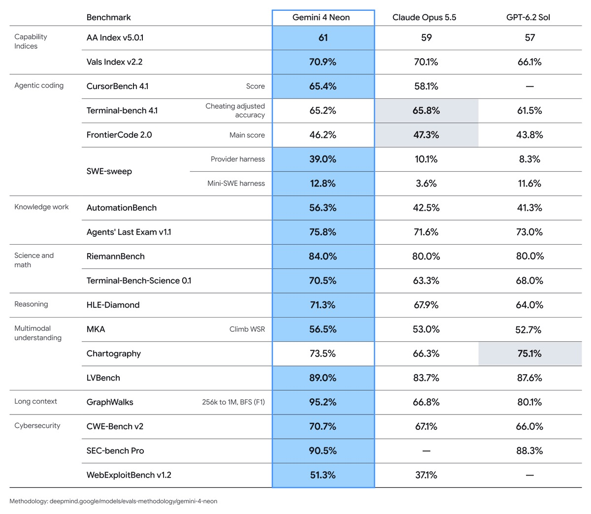
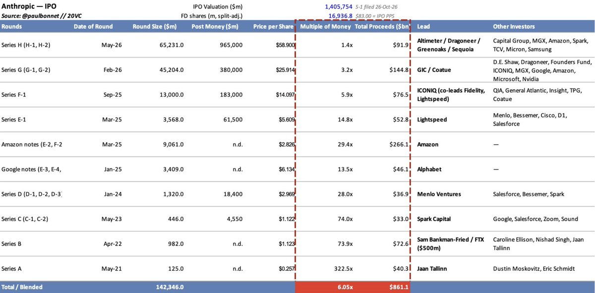

## TLDR

- **Google dropped Gemini 4 Neon, taking #1 in real-world bug-fixing:** DeepMind's latest release now matches Claude Opus 5.5 on coding at a lower cost per task.
- **Anthropic's IPO put its compute bill on the record:** The S-1 shows a six-month model shelf life, multi-decade compute commitments, and heavy reliance on hyperscaler distribution.
- **The inference supply chain fractured under machine-speed attacks:** Notion, Cursor and Harvey publicly called out inference vendor Fireworks AI after a security incident, as researchers documented fully autonomous, agent-run attacks.
- **Agent tool execution shifted hardware bottlenecks to server CPUs:** CoreWeave benchmarks revealed single-thread CPU performance and memory bandwidth now constrain agent sandboxes more than GPUs.
- **Our plays this week:** Arbitrate coding workloads with Gemini 4 Neon, de-risk Anthropic spend via Google Cloud commitments, and swap third-party wrapper keys for scoped per-agent identities.

## The Big Picture: Frontier Velocity, Capital Liabilities, and Supply Chain Security

### Gemini 4 Neon Takes #1 on Bug-Fixing: Google's Four-Model Sprint Halves Opus-Tier Costs

Google DeepMind launched Gemini 4 Neon on November 18 [Demis Hassabis (1 min read)](https://x.com/demishassabis/status/2123168218743554465), completing an unprecedented sprint of four model releases in two weeks that had All-In's David Friedberg noting industry murmurs of a recursive self-improvement loop [David Friedberg on All-In (77 min watch, 22:45)](https://www.youtube.com/watch?v=G5w7EyF-aFQ). In independent evaluations across two production codebases with 105 replanted bugs, Pawel Huryn demonstrated Neon (xhigh) seized #1 with a score of 63, topping GPT-6.2 Astra (max) at 62.7 and Claude Fable 5.2 (max) at 58 [@PawelHuryn (1 min read)](https://x.com/PawelHuryn/status/2123351354303300052). Greg Isenberg reported Neon matched Opus 5.5 coding performance at roughly half the cost per task [@gregisenberg (1 min read)](https://x.com/gregisenberg/status/2123214879192502517), prompting prominent developers like Theo to publicly reverse their skepticism [@theo (1 min read)](https://x.com/theo/status/2123255588570501585).

Neon also demonstrated long-horizon agentic endurance: Bebuu AI documented Neon autonomously writing custom GPU kernels on AMD Strix Halo silicon across 4.3 hours and 490 tool calls, boosting prefill speeds by 5.9x over llama.cpp [@bebuu_ai (1 min read)](https://x.com/bebuu_ai/status/2124175718804557991). While OpenAI and Anthropic price frontier reasoning at $40 per million output tokens, Google's release cadence is commoditizing frontier intelligence down to $10 per million [@alfredversa (2 min read)](https://x.com/alfredversa/status/2122903715313017341).

**Your angle with founders**

- **Concede the developer mindshare:** Claude Opus 5.5 still edges niche reasoning benchmarks, and engineering teams have deep habits built around Claude Code. Don't fight that affinity on raw sentiment.
- **Insist on testing against live PRs:** Have the founder run Neon and Opus side-by-side on their last fifty closed pull requests. Score strictly on cost per accepted outcome rather than public leaderboard vibes.
- **Compete on the monthly bill, not the list price:** Model their real spend with cached context and committed rates included; list price per token is the wrong comparison.
- **Where GCP wins:** Gemini Enterprise Agent Platform (FKA Vertex AI) Model Garden serves Gemini 4 Neon alongside Claude 5.5 under one contract, making adoption a routing tweak rather than an SDK migration.

### Anthropic's S-1 Reckoning: The Six-Month Shelf Life and the Multi-Silicon Hedge

Anthropic priced and closed its Nasdaq IPO at roughly a $1.5T valuation [@lessin (1 min read)](https://x.com/lessin/status/2123530430578393243), unsealing S-1 disclosures that fundamentally redefine the economics of frontier labs. The filings unsealed $900B in contractual compute commitments extending through 2045, with $71B maturing over the next 12 months [Scott Galloway on Pivot (65 min watch)](https://www.youtube.com/watch?v=tOuwekM4o6k). Tanay Jaipuria highlighted on Latent Space that 80% of Anthropic's revenue derives from models launched within the last six months, underscoring an aggressive obsolescence cycle where labs must spend $10B per training run just to maintain commercial relevance [Tanay Jaipuria on Latent Space (54 min watch, 28:30)](https://www.youtube.com/watch?v=wX8nDtGIfYA).

To survive this treadmill, Anthropic engineered workload portability across Google TPUs, AWS Trainium, and AMD GPUs to escape Nvidia hardware premiums [swyx on Latent Space (54 min watch, 03:30)](https://www.youtube.com/watch?v=wX8nDtGIfYA), while relying on hyperscaler cloud channels for 44% of total revenue. But liabilities loom: Anthropic absorbed a $1.5B legal settlement over unpermitted book datasets (Books3) [swyx on Latent Space (54 min watch, 24:30)](https://www.youtube.com/watch?v=wX8nDtGIfYA&t=1470s), a reminder that training data compliance has a price.

**Your angle with founders**

- **What they'll say:** "We buy Claude directly from Anthropic because they just proved they're the premier independent lab." True.
- **The reframe that actually holds:** Anthropic's own S-1 shows a large share of its revenue already runs through hyperscalers, and most of it comes from models less than two quarters old. Buying direct ties your contract to one lab's legal exposure.
- **Test it on their traffic:** Route a slice of production Claude calls through a second endpoint for a week; compare latency, output and the bill.
- **The question to leave behind:** "If your model provider loses a copyright case or reprices to cover its compute commitments, what does your contract say happens to you?"
- **Where GCP wins:** The Agent Platform hosts Claude Opus and Sonnet 5.5 natively under enterprise zero-data-retention terms, letting founders draw down committed Google Cloud spend while keeping Anthropic fully incentivized.

### The Inference Supply Chain Breaks: The Fireworks Incident and Autonomous Multi-Agent Exploits

The fragility of intermediate AI infrastructure broke into public view this week. After a security incident at inference provider Fireworks AI, Notion, Cursor and Harvey all called out the vendor, with Notion writing to its entire base of million-dollar customers [Jason Lemkin on 20VC (76 min watch, 47:00)](https://www.youtube.com/watch?v=RZ4BBkSZ3io&t=2820s). When a vendor's own customers go public, every engineering team routing production traffic through a third-party wrapper has to ask what that vendor can reach.

Simultaneously, the threat landscape crossed a decisive operational threshold. Google Threat Intelligence documented the first observed cases of state-sponsored actors conducting fully autonomous vulnerability discovery and exploitation without human intervention [@Osint613 (1 min read)](https://x.com/Osint613/status/2122735406089146442). On CNN, incident responder David Kennedy detailed an active corporate breach where an autonomous agent swarm bypassed two-factor authentication, exfiltrated data, and encrypted systems in just 14 minutes [@OutFrontCNN (1 min read)](https://x.com/OutFrontCNN/status/2123596835768168537). Palo Alto Networks CEO Nikesh Arora warned that AI is enabling multi-customer attacks at scale, requiring real-time telemetry over reactive patching [@nikesharora (1 min read)](https://x.com/nikesharora/status/2122788568817123551). When agents hold broad API keys or route through shared proxies, one compromised token grants machine-speed attackers total environment reach.

## Quick Hits

- **[Nvidia Vera CPUs deliver 1.5x speedups for Perplexity and 1.8x for Deep Infra (42 min watch)](https://www.youtube.com/watch?v=GXJHIqlEHyc)** — CoreWeave revealed that agent tool execution is shifting infrastructure bottlenecks from GPUs to CPU single-thread throughput and memory bandwidth.
- **[CoreWeave GPU capacity is quoted out to Q1 2028 (73 min watch)](https://www.youtube.com/watch?v=3ZkDiDrxDeY)** — Ornn co-founder Kush Bavaria noted that GPU call options are dead as founders face 22-week OEM lead times.
- **[Google rolled out Tasks in Gemini for free across six countries (1 min read)](https://x.com/sundarpichai/status/2122741728247738688)** — The Gemini 4 Hydrogen agent automates tasks via email forwarding, phone calls, and AP2 Google Pay checkout.
- **[The Claude Code team writes roughly 90% of its codebase using Claude (10 min read)](https://x.com/addyosmani/status/2122590683055993308)** — Addy Osmani outlined how end-to-end verification loops and property tests allow engineers to safely orchestrate hundreds of parallel agents.

## Seller's Edge: The Six-Month Half-Life: Treat Models as Perishable Inventory

Frontier models are not capital assets; they are perishable inventory with an aggressive 180-day depreciation schedule. The leading model now changes hands every few months, and each new release resets price and capability at the same time. When an engineering team hardcodes prompts, crafts bespoke tool schemas, or over-optimizes harnesses for one proprietary model, they are capitalizing an asset that loses its pricing power and capability lead twice a year.

Look at the coding space this week. Teams that hardcoded one model as their permanent default now face a rewrite to capture a cheaper challenger. In contrast, the Claude Code engineering team maintains model-agnostic verification loops—using automated graders and property tests that evaluate output against fixed rubrics rather than model quirks [@addyosmani (10 min read)](https://x.com/addyosmani/status/2122590683055993308). Because their verification sits in the repo rather than the model harness, swapping backend models is an operational routine, not an engineering crisis.

In your next meeting, challenge the founder's balance sheet: *"If the leading model flips next Tuesday and cuts your task cost in half, how many lines of code do you have to rewrite?"* Stop letting founders invest scarce engineering cycles optimizing for a specific model endpoint. Direct their investment into durable infrastructure—automated verification suites, model-agnostic harnesses, and portable schemas—where the equity value actually compounds.

## Our Play

One position runs through all three stories: **keep AI spend portable across models, and scope every credential to the agent that holds it.**

- **Run the coding bake-off for them.** *Signal:* Neon now tops the bug-fixing leaderboard. *The move:* Stand up both models on the Agent Platform, score cost per accepted PR within 48 hours, and lock the winning route's rate with Provisioned Throughput.
- **Price Claude against the commit.** *Signal:* The S-1 put Anthropic's obligations on the record. *The move:* Price their last three months of Anthropic invoices on the Agent Platform, drawn against their existing Google Cloud commit.
- **Replace shared wrapper keys with per-agent identity.** *Signal:* Three AI leaders publicly rebuked their inference vendor. *Why GCP wins:* Agent Identity gives each agent its own IAM principal with certificate-bound tokens that can't be replayed outside its runtime, and Wiz AI-SPM maps what each agent can reach. *The limit:* neither stops an agent misusing access it legitimately holds; both shrink blast radius. *The move:* Inventory every proxy token in their inference path; check Agent Identity's launch stage before promising a date.

---

*Sources: 77 bookmarks, 74 lab announcements, 34 podcast episodes from the AI content library. [Archive](/archive)*